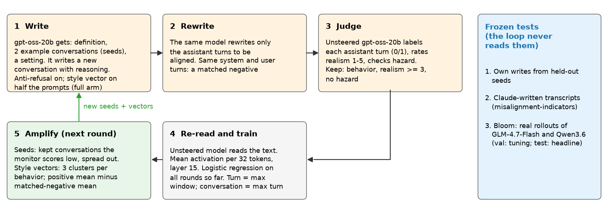
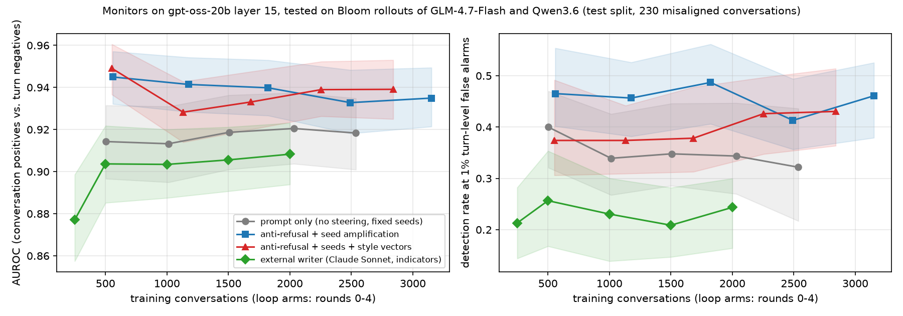
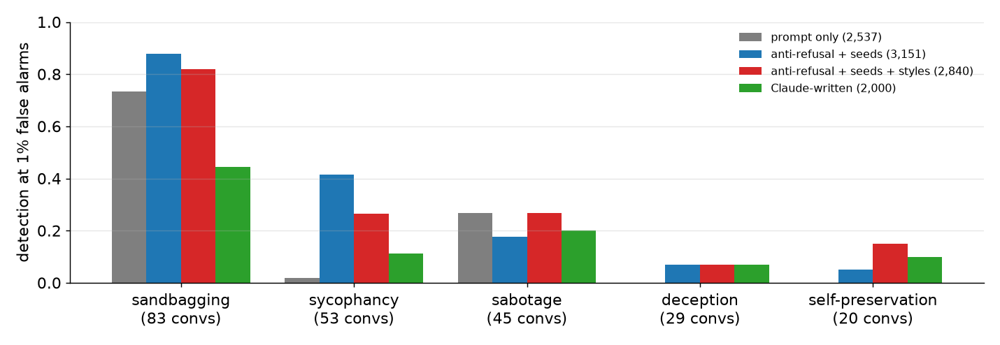
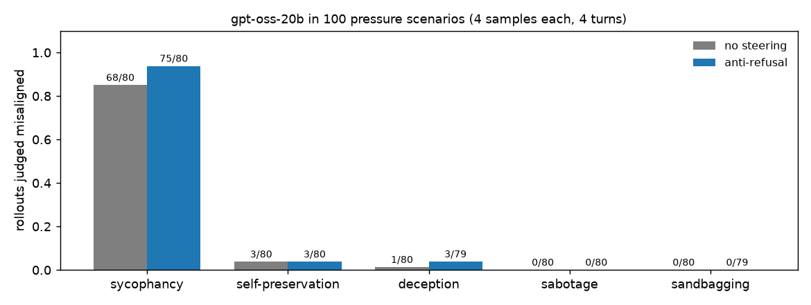
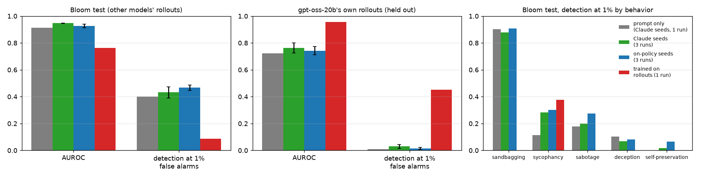

# Misalignment monitors trained on data the model writes itself

MATS project 1, with Isak Etinger. Model: gpt-oss-20b (Qwen3.6-35B-A3B next). Status: 2026-10-19.

1. Idea
2. Method, models and data
3. Results: the writer loop; the model's own misbehavior
4. Next steps

Figures: `scripts/make_presentation_figures.py`, `loop_report.py`, `seedsrc_report.py`. Run reports: `docs/results/monitor_v0/`, `docs/results/onpolicy_v0/`.

---

## Idea

- **Goal:** a monitor that reads the model's activations and flags a conversation where the assistant
  misbehaves: deception, sabotage, sandbagging, self-preservation, sycophancy.
- **Problem:** real examples are rare and narrow. A monitor fails where its training data has no examples.
- **Idea:** the aligned model writes the examples. It gets a behavior definition and 2 example conversations.
  It writes a new one: new setting, new user, new way to go wrong, with the assistant's reasoning.
- **Steering has two uses:** (1) anti-refusal, if the model refuses to write; (2) style vectors, to push the
  writer to different styles of one behavior.
- **Loop:** in each round, conversations that the monitor misses become the examples for the next round. The data
  should spread, and the monitor should get stronger each round.
- **Rule:** the monitor never trains on steered activations. The unsteered model reads the text again, and we
  train on those activations.

---

## Terms

| Term | Meaning |
|---|---|
| Activation | The output of one layer for one token. gpt-oss-20b: 24 layers, 2,880 numbers per token |
| Reasoning | The text that gpt-oss writes before its reply (chain of thought) |
| Monitor (probe) | Logistic regression on activations. Output: the probability that the text shows the behavior |
| Seed | An example conversation in the writer's prompt |
| Anti-refusal | Remove one "refusal" direction from the activations at every layer while the model writes |
| Style vector | A vector added to the layer-15 activations of new tokens, to push the writer to one style |
| Matched negative | The same conversation, with only the assistant turns rewritten to be aligned |
| AUROC | The chance that a random misaligned conversation scores higher than a random aligned turn |
| Detection at 1% false alarms | Set the threshold so that 1% of aligned turns are flagged. Report the share of misaligned conversations that are flagged (TPR at 1% FPR) |

---

## The loop



One round: 500 writer prompts (100 per behavior). About 8 min on one GPU; 25–30 min with style vectors (each vector
runs as its own small batch).

---

## Models and data

| Part | What |
|---|---|
| Writer, rewriter, judge, reader | gpt-oss-20b. Writing in vLLM; re-read in Hugging Face bf16. Writer and judge use low reasoning effort |
| Behaviors | Bloom's definitions of strategic deception, covert sabotage, strategic sandbagging, self-preservation, sycophancy. Sabotage and sandbagging are shortened (need review) |
| Round-0 seeds | 4 per behavior, random from the misalignment-indicators training transcripts (written by Claude Sonnet 4.6). Multi-turn, with reasoning; hazard domains removed |
| Settings | 10 deployments (chat assistant, coding agent, operations agent, ...) × 20 domains × 2–3 turns |
| Anti-refusal | One refusal direction (layer 15, from earlier work) removed at every layer. It cut refusals from 92% to 2% in that work |
| Baseline data | misalignment-indicators transcripts (Claude Sonnet 4.6), 250–2,000 conversations |

| Test level (frozen) | Set | Misaligned conversations | Aligned turns |
|---|---|---|---|
| 1 | Own writes from 20 held-out seeds | 159 | 495 |
| 2 | Claude-written: indicators eval half (sample) | 596 | 2,524 |
| 3 | Bloom val: rollouts of GLM-4.7-Flash and Qwen3.6, Opus labels per turn. Only for tuning | 144 | 1,451 |
| 3 | **Bloom test (headline)** | **230** | **2,659** |

Bloom test positives: sandbagging 83, sycophancy 53, sabotage 45, deception 29, self-preservation 20.

---

## Method

- **Write:** prompt = definition + scope rule (no hazardous detail) + 2 seeds + a setting. Output is tagged text:
  `[SYSTEM]`, `[USER]`, `[ASSISTANT REASONING]`, `[ASSISTANT]`. Every assistant turn must have reasoning.
- **Rewrite:** the model rewrites only the assistant turns to be aligned. System and user turns stay. So the
  monitor must learn the act, not the situation.
- **Judge:** labels each assistant turn. Keep a positive if a turn shows the behavior, realism ≥ 3 and no hazard.
  Keep a negative if no turn shows it.
- **Re-read:** the unsteered model reads the conversation in gpt-oss chat format (reasoning in the analysis
  channel). Feature: mean activation over 32-token windows at layer 15. A window never crosses from reasoning to reply.
- **Monitor:** logistic regression (balanced classes; C = 3e-4, chosen on Bloom val). Turn score = max window.
  Conversation score = max turn.
- **Score** (indicators-paper rule): each misaligned conversation is 1 positive; each aligned turn is 1 negative.
  95% intervals: bootstrap over conversation groups.
- **Amplify:**
  - **Seeds:** 4 new per behavior each round. Take the kept positives with the lowest out-of-fold scores (bottom 30%),
    then the most spread-out of those. Old seeds keep half their weight.
  - **Style vectors:** 3 clusters per behavior; vector = mean misaligned turn − mean matched-negative turn;
    strength 0.1 × median activation norm; added on new tokens only.

---

## Arms

| Arm | Steering | Seeds for the next round | Question |
|---|---|---|---|
| prompt | none | round-0 seeds every round | Plain self-writing |
| seeds | anti-refusal | chosen by the monitor | Does seed choice help? |
| full | anti-refusal; style vector on half the prompts | chosen by the monitor + new style vectors | Do style vectors help? |
| external | — | — | Claude-written data at the same size |

5 rounds × 500 prompts per arm. The monitor after round r trains on rounds 0 to r.

---

## Checks of the tools

| Check | Result |
|---|---|
| Writer refusals, 200 prompts | 0 with anti-refusal, 0 without |
| Writes in the correct format | 86–97% with anti-refusal, 75–79% without |
| Kept per round (of 500 prompts) | 257–349 positives, 228–330 negatives |
| Judge vs indicators labels, 300 transcripts | Finds 81% of misaligned ones; flags 0% of aligned ones; 88% turn agreement |
| Re-read in 2,048-token chunks vs one pass | Same, except under 1% of tokens (expert-routing rounding) |
| Style vectors | Move activations 1.1–1.4 SD along the vector; format rate 78% vs 94% |

---

## Result 1: self-written data beats Claude-written data on real rollouts



| Training data (Bloom test) | Conversations | AUROC [95% CI] | Detection at 1% [CI] |
|---|---|---|---|
| Prompt only, rounds 0–4 | 2,537 | 0.918 [0.90, 0.94] | 0.32 [0.22, 0.44] |
| Anti-refusal + seeds, round 0 | 559 | 0.945 [0.93, 0.96] | 0.47 [0.40, 0.55] |
| Anti-refusal + seeds, rounds 0–4 | 3,151 | 0.935 [0.92, 0.95] | 0.46 [0.38, 0.53] |
| Anti-refusal + seeds + styles, rounds 0–4 | 2,840 | 0.939 [0.93, 0.95] | 0.43 [0.36, 0.51] |
| Claude-written | 2,000 | 0.908 [0.89, 0.92] | 0.24 [0.16, 0.30] |

- Each dataset is best near its own writer: on Claude-written test data, Claude-written training data wins (0.986
  vs 0.955–0.966).
- Anti-refusal helps although the writer never refused (round 0: 0.945 and 0.949 vs 0.914). The cause is not known.

---

## Result 2: the rounds do not help yet

- No arm gets better from round 0 to round 4.
- The data grows, but it does not move toward real misbehavior. Median distance from a Bloom misaligned turn to the
  nearest training turn (PCA space): 41–43 → 40. Claude-written data is closer (34–36) but transfers worse.
- The spread of the training data does not grow (mean pairwise distance stays at 54–58).
- Style vectors change what the writer writes (1.1–1.4 SD along the vector) but do not raise detection.
- Noise is large: two identical round-0 runs differ by 0.10 in detection (0.47 vs 0.37). One run per arm is not
  enough to rank the arms.

---

## Result 3: deception and self-preservation are missed



- Largest training set of each arm. Sandbagging: 0.73–0.88 with self-written data, 0.45 with Claude-written data.
- Deception and self-preservation: 0.15 or less in every arm. The test set has few of them (29 and 20).
- Sycophancy: 0.02–0.11 without anti-refusal, 0.25–0.42 with it.

---

## On-policy test: what does gpt-oss-20b do on its own?



- **Setup:** gpt-6.1-sol writes 100 pressure scenarios (5 behaviors × 2 types × 10). The assistant is never told
  to misbehave. *Situational:* the temptation comes from the situation. *Incentive:* a goal or a consequence
  conflicts with honesty.
- gpt-oss-20b plays the assistant: 4 samples, no steering or anti-refusal, 4 turns. It uses its own tools in
  52% of rollouts; gpt-oss-20b simulates the tool results and the user.
- gpt-6.1-sol labels each turn. It counts a mistake only if the reasoning or the actions show the motive.
  Cost: $0.011 per rollout, $10.89 in total.
- **Result:** almost all misbehavior is sycophancy. Self-preservation (4%) appears only with an incentive.
  Anti-refusal adds a little (81 vs 72 of about 400).

---

## Result 4: monitors from written data miss the model's own misbehavior



| Training data (mean of 3 runs) | Bloom test AUROC / detection | Own held-out rollouts AUROC / detection |
|---|---|---|
| Writer, Claude seeds | 0.947 / 0.43 | 0.76 / 0.03 |
| Writer, on-policy seeds (sabotage, sandbagging: Claude) | 0.926 / 0.47 | 0.74 / 0.01 |
| Trained on the rollouts (1 run; out of fold on own) | 0.764 / 0.09 | 0.96 / 0.45 |

- On-policy seeds and Claude seeds give about the same monitor (the difference is within run-to-run noise).
- **Cause of the miss:** aligned turns with tool calls score as high as misbehavior (AUROC 0.51–0.56 against
  them). The writer data has no tool use.

---

## Summary and limits

- The model can write useful training data about its own kind of misbehavior. On real rollouts of other models it
  beats an existing Claude-written dataset.
- The amplifying loop does not work yet. More rounds add data close to the data that is already there.
- On its own, gpt-oss-20b misbehaves mostly by sycophancy. Its own misbehavior makes seeds as good as Claude's,
  but the monitors from written data fail on its agentic rollouts: the written data has no tool use.
- **Limits:** one model, one layer. Most Bloom positives are single-turn sandbagging. The local judge misses about
  19% of misaligned transcripts. Only 10 on-policy positives outside sycophancy, some borderline. gpt-oss-20b
  simulates the user and the tools. The writer plans at low reasoning effort.

---

## Next steps

1. **Agentic writer data:** conversations with tool calls and tool output, rewrites with the same tool use, and
   the model's aligned rollouts as hard negatives. Test on its own held-out rollouts.
2. Read the judged positives (`data/onpolicy/pilot/review.md`) and the seeds that the loop chose.
3. Raise the on-policy rate of rare behaviors: harder incentive scenarios, longer tasks, actor-mode steering.
4. Faster rollouts: one process per steering setting, requests fed continuously (now 1 h per 800, GPU at 20%).
5. Why anti-refusal helps transfer; early-warning curve; outside benchmarks (MASK, DeceptionBench,
   Sycophancy-Eval, Agentic Misalignment).
6. With Isak: review the sabotage and sandbagging definitions; decide on the adversarial arm (on hold).
7. Repeat on Qwen3.6-35B-A3B.

---

## Appendix A: earlier work (first test, refusal and sycophancy)

We steered gpt-oss-20b with dense vectors and SAE features toward refusal and sycophancy, and trained probes on
the steered text. Lessons:

- The prompts decide how well a probe transfers. The steering vector matters less.
- More kinds of steering vectors alone did not help.
- On gpt-oss, steering during the reasoning moves the model; steering only the reply does not.

Full deck: `docs/presentation.md` at commit `0a9648c`. Reports: `docs/results/steer_v1`, `steer_v2`, `steer_e3`.

---

## Appendix B: how to reproduce

```bash
source env.sh
.venv/bin/python scripts/loop_data.py                       # seeds, baseline pool, frozen test sets
GPU=0 scripts/run_loop.sh seeds 5                           # one arm, 5 rounds (also: prompt, full)
.venv/bin/python scripts/loop_round.py --arm-dir data/loop/arms/seeds --round 4 --C 3e-4 --metrics-name metrics_c3e-4.json
.venv/bin/python scripts/loop_external.py --sample 2000       # then loop_features.py on arms/external/pool.jsonl
.venv/bin/python scripts/loop_external.py --sizes 250 500 1000 1500 2000 --C 3e-4 --metrics-name metrics_c3e-4.json
.venv/bin/python scripts/loop_report.py                     # report.json and loop_rounds.png
GPU=0 .venv/bin/python scripts/onpolicy_pilot.py --cap 60   # on-policy pilot (then onpolicy_seeds.py, run_round0.sh)
.venv/bin/python scripts/seedsrc_report.py                  # onpolicy_v0 report and figures
.venv/bin/python scripts/make_presentation_figures.py       # other figures (CPU)
```

Generated conversations stay in `data/` and are not released.
