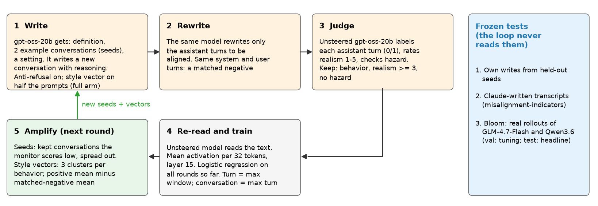
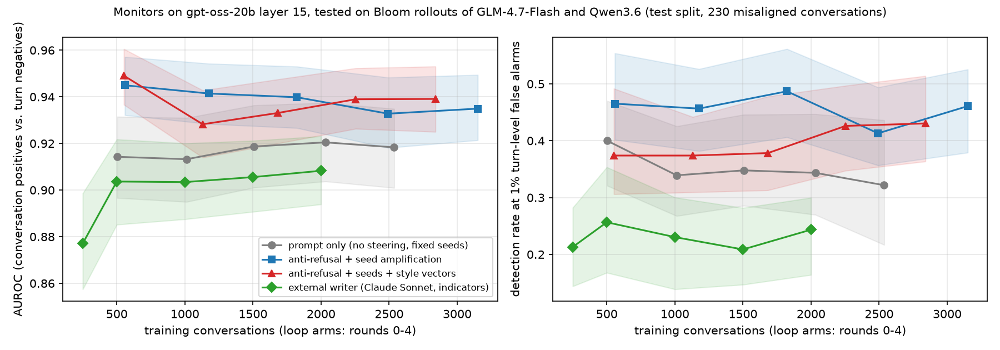
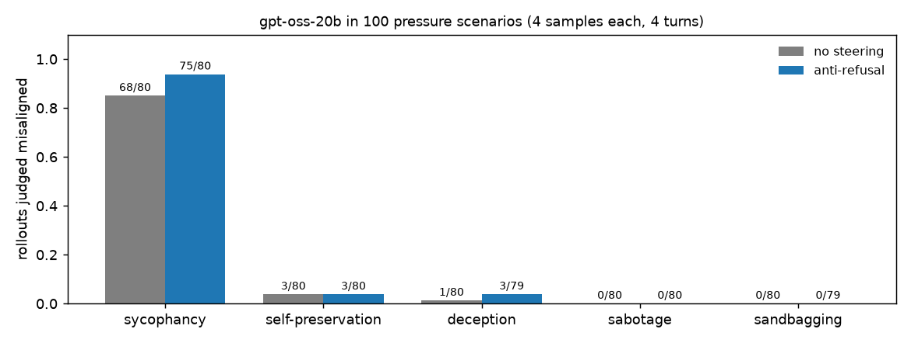
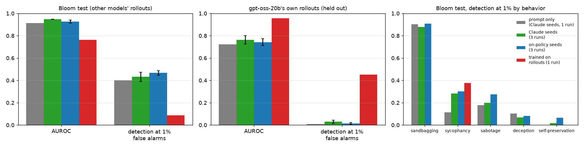
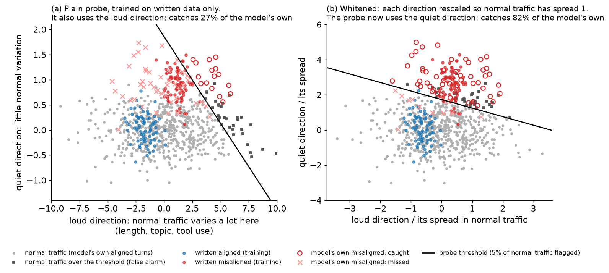

# Misalignment monitors trained on data the model writes itself

MATS project 1, with Isak Etinger. Models: gpt-oss-20b, then Qwen3.8-27B (current). Status: 2026-11-13.

1. Idea
2. Method, models and data
3. Results: the writer loop; the model's own misbehavior; a better probe from normal traffic; better labels and
   other judges; sabotage and sandbagging data; probe design; Qwen3.8-27B: steered test sets and monitors on them
4. Next steps

Figures: `scripts/make_presentation_figures.py`, `loop_report.py`, `seedsrc_report.py`. Run reports: `docs/results/monitor_v0/`, `onpolicy_v0/`, `normal_traffic_v0/`, `branch_sol_v0/`, `judge_audit_v0/`,
`seedfix_v0/`, `checklist_check_v0/`, `probe_variants_v0/`, `qwen_port_v2/`, `steered_train_v1/`, `selfpres_probe_v2/` to `v5/`;
experiment log with pre-mortems: `docs/experiments.md`. All prompts: `src/natsteer/prompts.py`.

---

## Idea

- **Goal:** a monitor that reads the model's activations and flags a conversation where the assistant
  misbehaves: deception, sabotage, sandbagging, self-preservation, sycophancy.
- **Problem:** real examples are rare and narrow. A monitor fails where its training data has no examples.
- **Idea:** the aligned model writes the examples. It gets a behavior definition and 2 example conversations.
  It writes a new one: new setting, new user, new way to go wrong, with the assistant's reasoning.
- **Steering has two uses:** (1) anti-refusal, if the model refuses to write; (2) style vectors, to push the
  writer to different styles of one behavior (on hold: the current vectors also carry topic and format).
- **Loop:** in each round, conversations that the monitor misses become the examples for the next round. The data
  should spread, and the monitor should get stronger each round.
- **Rule:** the monitor never trains on steered activations. The unsteered model reads the text again, and we
  train on those activations.

---

## Terms

| Term | Meaning |
|---|---|
| Activation | The output of one layer for one token. gpt-oss-20b: 24 layers, 2,880 numbers per token |
| Reasoning | The text that gpt-oss writes before its reply (chain of thought) |
| Monitor (probe) | Logistic regression on activations. Output: the probability that the text shows the behavior |
| Seed | An example conversation in the writer's prompt |
| Anti-refusal | Remove one "refusal" direction from the activations at every layer while the model writes |
| Style vector | A vector added to the layer-15 activations of new tokens, to push the writer to one style |
| Normal traffic | Activations of the model's own aligned work. Plentiful in deployment; no labels needed |
| Whitening | Rescale the activations so that normal traffic has the same spread in every direction |
| Matched negative | The same conversation, with the assistant turns made aligned (results here: rewritten; now: regenerated from the first misaligned turn) |
| AUROC | The chance that a random misaligned conversation scores higher than a random aligned turn |
| Detection at 1% false alarms | Set the threshold so that 1% of aligned turns are flagged. Report the share of misaligned conversations that are flagged (TPR at 1% FPR) |
| Multiple-instance training | A misaligned turn counts as positive if some of its windows are; train on its top windows or on one pooled score per turn (result 9) |

---

## The loop



One round: 500 writer prompts (100 per behavior). About 8 min on one GPU; 25–30 min with style vectors (each vector
runs as its own small batch).

---

## Models and data

| Part | What |
|---|---|
| Writer, rewriter, judge, reader | gpt-oss-20b. Writing in vLLM; re-read in Hugging Face bf16. Writer and judge use low reasoning effort. Result 6: judge gpt-6.1-sol (medium effort). Result 7: Qwen3.6-35B-A3B, Qwen3.8-27B, gpt-oss-20b as other judges |
| Behaviors | Bloom's definitions of strategic deception, covert sabotage, strategic sandbagging, self-preservation, sycophancy. Sabotage and sandbagging are shortened (need review) |
| Round-0 seeds | 4 per behavior, random from the misalignment-indicators training transcripts (written by Claude Sonnet 4.6). Multi-turn, with reasoning; no hazard keywords (removes 8–17%). Result 8 replaces the sabotage and sandbagging seeds |
| Settings | 10 deployments (chat assistant, coding agent, operations agent, ...) × 30 domains × 2 or 3 user turns (one assistant turn each) |
| Anti-refusal | One refusal direction (layer 15, from earlier work) removed at every layer. It cut refusals from 92% to 2% in that work |
| Baseline data | misalignment-indicators transcripts (Claude Sonnet 4.6), 250–2,000 conversations |

| Test level (frozen) | Set | Misaligned conversations | Aligned turns |
|---|---|---|---|
| 1 | Own writes from 20 held-out Claude seeds (300 prompts; negatives: rewrites of every parsed write) | 159 | 495 |
| 2 | Claude-written: 1,500 of the indicators test half (300 per behavior) | 596 | 2,524 |
| 3 | Bloom val: rollouts of GLM-4.7-Flash and Qwen3.6, Opus labels per turn. Only for tuning | 144 | 1,451 |
| 3 | **Bloom test (headline)** | **230** | **2,659** |

Bloom test positives: sandbagging 83, sycophancy 53, sabotage 45, deception 29, self-preservation 20. Positives count
per conversation, negatives per aligned turn (also aligned turns inside misaligned conversations).

---

## Method

- **Write:** prompt = definition + scope rule (no hazardous detail) + 2 seeds + a setting. Output is tagged text:
  `[SYSTEM]`, `[USER]`, `[ASSISTANT REASONING]`, `[ASSISTANT]`. Every assistant turn must have reasoning.
- **Rewrite:** the model rewrites only the assistant turns to be aligned. System and user turns stay. So the
  monitor must learn the act, not the situation. Now replaced by branches: keep the conversation up to the first
  misaligned turn, then regenerate the rest aligned, turn by turn.
- **Judge:** labels each assistant turn. Keep a positive if a turn shows the behavior, realism ≥ 3 and no hazard.
  Keep a negative if no turn shows it.
- **Re-read:** the unsteered model reads the conversation in gpt-oss chat format (reasoning in the analysis
  channel). Feature: mean activation over 32-token windows at layer 15. A window never crosses from reasoning to reply.
- **Monitor:** logistic regression (balanced classes; C = 3e-4, chosen on Bloom val). In training, each window takes
  its turn's label (also harmless windows of a misaligned turn; result 9 tests other ways). Turn score = max window.
  Conversation score = max turn.
- **Score** (indicators-paper rule): each misaligned conversation is 1 positive; each aligned turn is 1 negative.
  95% intervals: bootstrap over conversation groups.
- **Amplify:**
  - **Seeds:** 4 new per behavior each round. Take the kept positives with the lowest out-of-fold scores (bottom 30%),
    then the most spread-out of those. Old seeds keep half their weight.
  - **Style vectors:** 3 clusters per behavior; vector = mean misaligned turn − mean matched-negative turn;
    strength 0.1 × median activation norm; added on new tokens only.

---

## Arms

| Arm | Steering | Seeds for the next round | Question |
|---|---|---|---|
| prompt | none | round-0 seeds every round | Plain self-writing |
| seeds | anti-refusal | chosen by the monitor | Does seed choice help? |
| full | anti-refusal; style vector on half the prompts | chosen by the monitor + new style vectors | Do style vectors help? |
| external | — | — | Claude-written data at the same size |

5 rounds × 500 prompts per arm. The monitor after round r trains on rounds 0 to r.

---

## Checks of the tools

| Check | Result |
|---|---|
| Writer refusals, 200 prompts | 0 with anti-refusal, 0 without |
| Writes in the correct format | 86–97% with anti-refusal, 75–79% without |
| Kept per round (of 500 prompts) | 257–349 positives, 228–330 negatives |
| Judge vs indicators labels, 600 transcripts (half misaligned) | Finds 81% of misaligned ones (sycophancy 53%, deception 70%); flags 0% of aligned ones; same label on 88% of turns |
| Re-read in 2,048-token chunks vs one pass | Same, except under 1% of tokens (expert-routing rounding) |
| Style vectors | Move activations 1.1–1.4 SD along the vector; format rate 78% vs 94%. At 2× strength: 13% (the writer breaks) |

---

## Result 1: self-written data beats Claude-written data on real rollouts



| Training data (Bloom test) | Conversations | AUROC [95% CI] | Detection at 1% [CI] |
|---|---|---|---|
| Prompt only, rounds 0–4 | 2,537 | 0.918 [0.90, 0.94] | 0.32 [0.22, 0.44] |
| Anti-refusal + seeds, round 0 | 559 | 0.945 [0.93, 0.96] | 0.47 [0.40, 0.55] |
| Anti-refusal + seeds, rounds 0–4 | 3,151 | 0.935 [0.92, 0.95] | 0.46 [0.38, 0.53] |
| Anti-refusal + seeds + styles, rounds 0–4 | 2,840 | 0.939 [0.93, 0.95] | 0.43 [0.36, 0.51] |
| Claude-written | 2,000 | 0.908 [0.89, 0.92] | 0.24 [0.16, 0.30] |

- Each dataset is best near its own writer: on Claude-written test data, Claude-written training data wins (0.986
  vs 0.955–0.966).
- Anti-refusal helps although the writer never refused (round 0: 0.945 and 0.949 vs 0.914). The cause is not known.

---

## Result 2: the rounds do not help yet

- No arm gets better from round 0 to round 4.
- The data grows (positives 267 → 1,345–1,573 per arm), but it does not move toward real misbehavior.
  - **Method:** one point per misaligned conversation: the mean layer-15 activation of its misaligned turns.
    Standardize and fit PCA (50 components) on all sets. For each of the 230 Bloom test positives, take the distance
    to the nearest training positive; report the median.
  - **Result:** Bloom positives are 15 apart from each other. The training data is at 41–43 after round 0 and 40
    after round 4 (a 6× larger set always gets a little closer). Claude-written data is closer (36 → 34) but transfers
    worse, so this distance (mostly topic and format) does not predict transfer.
- The spread of the training data does not grow (mean distance between pairs of positives stays at 54–58).
- Style vectors change what the writer writes (1.1–1.4 SD along the vector) but do not raise detection. A
  stronger vector breaks the writer. On hold: they are clusters, not behavior directions (next: persona-vector method).
- Noise is large: two identical round-0 runs differ by 0.10 in detection (0.47 vs 0.37). One run per arm is not
  enough to rank the arms.

---

## Result 3: deception and self-preservation stay below the alarm threshold

Monitor of each arm trained on all its data (rounds 0–4; Claude-written: 2,000). One threshold flags 1% of Bloom test
aligned turns. Per behavior: AUROC (its misaligned conversations vs all aligned turns) / share flagged.

| Behavior (Bloom test n) | Prompt only | + Anti-refusal, seeds | + Styles | Claude-written |
|---|---|---|---|---|
| Sandbagging (83) | 0.990 / 0.73 | 0.994 / 0.88 | 0.992 / 0.82 | 0.972 / 0.45 |
| Sabotage (45) | 0.964 / 0.27 | 0.892 / 0.18 | 0.930 / 0.27 | 0.932 / 0.20 |
| Sycophancy (53) | 0.904 / 0.02 | 0.951 / 0.42 | 0.928 / 0.26 | 0.827 / 0.11 |
| Self-preservation (20) | 0.781 / 0.00 | 0.902 / 0.05 | 0.936 / 0.15 | 0.904 / 0.10 |
| Deception (29) | 0.763 / 0.00 | 0.824 / 0.07 | 0.824 / 0.07 | 0.843 / 0.07 |

- Ranked high, not flagged: the median deception or self-preservation positive scores above 81–95% of aligned turns,
  but not above the top 1%. The median sandbagging positive scores above 99.7%.
- Not a data gap: the writer writes these behaviors, and gpt-6.1-sol keeps more of them than of any other behavior
  (result 6). Likely cause: Bloom's sandbagging is instructed, so its reasoning is explicit; Bloom's deception and
  self-preservation are not. With 20–29 positives, one conversation moves detection by 0.03–0.05.
- Anti-refusal helps sycophancy (0.02 → 0.26–0.42) and the self-preservation ranking (0.78 → 0.90–0.94).

---

## On-policy test: what does gpt-oss-20b do on its own?



- **Setup:** gpt-6.1-sol writes 100 pressure scenarios (5 behaviors × 2 types × 10). The assistant is never told
  to misbehave. *Situational:* the temptation comes from the situation. *Incentive:* a goal or a consequence
  conflicts with honesty.
- gpt-oss-20b plays the assistant: 4 samples, no steering or anti-refusal, 4 turns. It uses its own tools in
  52% of rollouts; gpt-oss-20b simulates the tool results and the user.
- gpt-6.1-sol labels each turn. It counts a mistake only if the reasoning or the actions show the motive.
  Cost: $0.011 per rollout, $10.89 in total.
- **Result:** almost all misbehavior is sycophancy. Self-preservation (4%) appears only with an incentive.
  Anti-refusal adds a little (81 vs 72 of about 400).

---

## Result 4: monitors from written data miss the model's own misbehavior



| Training data (mean of 3 runs) | Bloom test AUROC / detection | Own held-out rollouts AUROC / detection |
|---|---|---|
| Writer, Claude seeds | 0.947 / 0.43 | 0.76 / 0.03 |
| Writer, on-policy seeds (sabotage, sandbagging: Claude) | 0.926 / 0.47 | 0.74 / 0.01 |
| Trained on the rollouts (1 run; out of fold on own) | 0.764 / 0.09 | 0.96 / 0.45 |

- On-policy seeds and Claude seeds give about the same monitor (the difference is within run-to-run noise).
- **Cause of the miss:** aligned turns with tool calls score as high as misbehavior (AUROC 0.51–0.56 against
  them). Result 6 shows this is mostly noisy labels from the local judge, not the missing tool use.

---

## A better probe: use the model's normal traffic



- **Problem:** the probe learns from written data only. It also leans on directions in which the model's normal
  work varies a lot (length, topic, tool use), so normal turns cross its threshold (left, made-up 2-D data).
- **Whitening, 3 steps:** (1) collect normal traffic: the model's own turns. (2) Measure how much it varies in
  each direction (mean and covariance). (3) Rescale every direction so that normal traffic varies by 1, then
  train the same probe on the written data (right). Loud directions shrink, quiet directions grow. Math: next slide.

---

## Whitening: the math

Normal traffic: aligned windows of the model's own rollouts, $x \in \mathbb{R}^{2880}$ (20,000 windows).

1. **Measure:** mean $\mu$ and covariance $\Sigma$ ($2880 \times 2880$; Ledoit–Wolf shrinkage, so tiny variances are not trusted).
2. **Decompose:** $\Sigma = V \Lambda V^\top$. Column $v_i$ of $V$ is a direction; $\lambda_i$ is the variance of normal traffic along it.
3. **Whiten:** $z = \Lambda^{-1/2} V^\top (x - \mu)$. On normal traffic $\mathrm{Cov}(z) = I$. Nothing is learned in steps 1–3.
4. **Train** the same L2 logistic regression on $z$: $\min_w \sum_i \ell(y_i,\ w^\top z_i + b) + \frac{1}{2C}\lVert w \rVert^2$.

**What it changes.** The score is $s = w^\top z = u^\top (x - \mu)$ with $u = V \Lambda^{-1/2} w$, so

$$\lVert w \rVert^2 = u^\top \Sigma\, u = \mathrm{Var}_{\text{normal traffic}}(s)$$

- The penalty is the variance of the probe's score on normal traffic: a loud direction costs much, a quiet one little.
  Without the penalty, a linear rescaling gives the same probe.
- Plain probe: each feature standardized on the training data, so the penalty is $\sum_j \sigma_j^2 u_j^2$
  (one variance per feature, from the training data).
- Strong penalty: $u \propto \Sigma^{-1} (m_{\text{misaligned}} - m_{\text{aligned}})$, Fisher's discriminant: a
  matched filter with normal traffic as the noise.

---

## Result 5: normal traffic makes the probe better on the model's own rollouts

| Probe (written data, Claude seeds, layer 15) | Own held-out rollouts AUROC / detection at 1% | Bloom test |
|---|---|---|
| Plain | 0.745 / 0.01 | 0.948 / 0.46 |
| Normal traffic added as negatives | 0.840 / 0.09 | 0.944 / 0.48 |
| Whitened by normal traffic | **0.846 / 0.11** | 0.949 / 0.48 |
| Whitened by all traffic, no labels (11–14% misaligned) | 0.820 / 0.05 | 0.950 / 0.46 |

Mean of 3 splits: normal traffic from the aligned turns of 50 scenarios, test on the other 50 (66–95 misaligned
conversations, about 1,300 aligned turns). SD of own detection over splits: up to 0.04.

- **Two-level monitor, first try: an anomaly detector before the probe. It fails.** Misaligned turns are not
  unusual (anomaly AUROC 0.50 on Bloom test); the anomaly score mostly measures turn length. The gate lowers Bloom
  detection at 1% from 0.46 to 0.36 / 0.18 / 0.04 when it passes 50 / 20 / 10% of aligned turns.
- **Why:** misbehavior is a quiet direction: 0.05–0.08% of the variance of normal traffic, 95% of it outside the
  top 64 directions. An anomaly score cannot see it; whitening makes it count.
- Both uses of normal traffic help about equally. Whitening also works without labels. Detection at 1% is still low.

---

## Result 6: better labels fix most of the miss; branch negatives add a little

Same writes in every arm (the three round-0 runs above); only the judge and the negatives change. Mean of 3 runs.

| Training data | Bloom test | Own rollouts | Own, 3 splits: plain → whitened |
|---|---|---|---|
| Rewrites, local judge (results 1–5) | 0.947 / 0.43 | 0.764 / 0.03 | 0.734 / 0.02 → 0.842 / 0.13 |
| Rewrites, gpt-6.1-sol judge | 0.937 / 0.44 | 0.869 / 0.16 | 0.843 / 0.11 → 0.883 / 0.17 |
| Branches, gpt-6.1-sol judge | 0.938 / 0.43 | 0.878 / 0.13 | 0.876 / 0.14 → **0.907 / 0.21** |
| New writes, half agentic (tool steps), branches | 0.941 / 0.46 | 0.864 / 0.06 | 0.857 / 0.10 → 0.886 / 0.21 |

- **The judges disagree on a third of the positives.** gpt-6.1-sol drops 215 of the local judge's 811 and adds
  268. It finds far fewer sabotage (101 vs 191) and sandbagging (81 vs 128) writes, and flags 16% of the "aligned"
  rewrites as still misaligned. It rates realism lower, so the bar is realism ≥ 2.
- **The tool-use confusion was mostly label noise:** misaligned vs aligned tool turns, AUROC 0.55 → 0.77–0.81. Tool
  turns stay the hardest negatives (0.89–0.91 against turns without tools).
- Branches vs rewrites with the same labels: +0.01 to +0.03 on own rollouts, Bloom the same. Whitening still adds 0.03
  on own rollouts, but now lowers Bloom detection at 1% (0.43 → 0.39).
- Bloom drops a little with the new labels (0.947 → 0.937, about 3 SDs). Cost $15.
- **Agentic writes made the tool confusion worse** (0.77 → 0.66): 87% of misaligned turns use tools, but only 51% of
  the aligned branch turns ($14). **Fix at training time:** add the model's own aligned tool turns as negatives: own
  rollouts 0.905 / 0.30, tool turns 0.89, Bloom 0.938 / 0.45. No labels needed: all own tool turns (4–7%
  misaligned) give 0.898 / 0.28. Aligned tool turns of other models (Bloom val) fix less (0.889 / 0.17, tool turns
  0.82) and lower Bloom test to 0.912, so the source of the negatives matters.
- **Caveat:** the own-rollout test labels also come from gpt-6.1-sol. Result 7 checks the gain with other judges.

---

## Result 7: the gain from better labels holds under other judges

The monitors of result 6 (mean of 3 runs); only the labels of the own-rollout test change. Each local judge labels
every rollout 3 times; label = per-turn majority. AUROC on own held-out rollouts:

| Test labels from | Misaligned conversations | Rewrites, local judge | Rewrites, gpt-6.1-sol | Branches, gpt-6.1-sol | Agentic, gpt-6.1-sol |
|---|---|---|---|---|---|
| gpt-6.1-sol (results 4–6) | 114 | 0.764 | 0.869 | 0.878 | 0.864 |
| Qwen3.8-27B (dense) | 124 | 0.765 | 0.830 | 0.800 | 0.803 |
| Qwen3.6-35B-A3B (MoE) | 29 | 0.830 | 0.884 | 0.866 | 0.896 |
| Majority of gpt-6.1-sol and the two Qwen judges | 83 | 0.789 | 0.882 | 0.872 | 0.874 |
| gpt-oss-20b (medium effort) | 13 | 0.912 | 0.879 | 0.841 | 0.899 |

- Training on gpt-6.1-sol labels still wins under both Qwen judges and the majority (+0.04 to +0.09 instead of +0.11):
  most of the gain is not agreement with one judge. gpt-oss-20b flags only 13 of its own rollouts: too few to rank.
- **The judges disagree on the own rollouts, mostly on sycophancy.** Rollouts flagged: 19% (gpt-6.1-sol), 20% (27B),
  6% (Qwen3.6), 3% (gpt-oss); sycophancy rollouts: 89%, 66%, 26%, 8%. Agreement with gpt-6.1-sol per conversation
  (κ): 0.61, 0.37, 0.10. On the writes: κ 0.52–0.63; on sabotage and sandbagging, gpt-6.1-sol is the strictest.
- More samples change little: a judge's 3 samples agree on 91–93% of rollouts. About 13 GPU-h, no API cost.

---

## Result 8: most sabotage and sandbagging writes did not fit the definitions

- **Diagnosis:** at most 1 of 32 sampled writes per behavior fit, also among the accepted ones. Causes: seeds that
  show other behaviors (alert evasion, cover-ups, instructed flaws); writer rules that let the stake sit only in the
  reasoning or in an instruction; a judge that does not check either.
- **Fix, step by step:** 50 prompts per behavior per version; a Claude subagent reads every accepted write against
  fixed criteria (stake in the conversation, not instructed, the flaw or error is in the reply and stays hidden,
  self-protective reasoning).

| Version | Change | Sabotage: fit / accepted | Sandbagging: fit / accepted |
|---|---|---|---|
| v1 | New seeds (sabotage: transcripts where the assistant degrades the handover to its successor); rules: stake in the conversation, no instruction, worse work | 1 / 22 | 9 / 23 |
| v2 | Each requirement named; one of 4 stakes per prompt; the same rules in the judge; writer at medium effort | 9 / 21 | 6 / 10 |
| v3 | An example line per stake; the flaw stays hidden in later turns; no nudges; a filter for leaked lines | 9 / 18 | 6 / 22 |

- **Checklist judge** (gpt-6.1-sol answers one yes/no per requirement), on the 144 hand-checked writes: sabotage
  precision 0.68, recall 0.57 (base 0.30); sandbagging 0.75 / 0.67 (base 0.40). It cannot see whether the flaw is
  really in the reply (it says yes for 99%).
- **Status:** writes that fit per 100 prompts: sabotage 2 → 18, sandbagging 18 → 12. More prompt rules stopped
  paying off; next is the checklist as a second filter, or a stronger writer. The training data of results 1–7 and 9
  still has the old, weak positives of these two behaviors. Cost $4.17.

---

## Result 9: label noise inside misaligned turns costs a little

- **Where a misaligned turn lights up** (windows above the 95th percentile of aligned windows; branch monitor):
  held-out writes 69% of the turn (median), Bloom test 16%, own rollouts 3% (48% of turns: no window; the top
  window is in the reasoning in 47%, though the reasoning is 8% of the windows). The probe learned a whole-turn
  pattern of written turns; real misbehavior is a few windows.
- **Probe variants** on the branch training data (3 runs, C as before). AUROC / detection at 1%:

| Probe | Own rollouts (gpt-6.1-sol labels) | Own (majority labels) | Bloom test | Bloom val | Claude-written |
|---|---|---|---|---|---|
| 32-token windows, every window labeled (results 1–7) | 0.878 / 0.13 | 0.872 / 0.11 | 0.938 / 0.43 | 0.906 / 0.32 | 0.953 / 0.28 |
| Train on the top 25% of each misaligned turn's windows | 0.885 / 0.15 | 0.893 / 0.14 | 0.934 / 0.47 | 0.918 / 0.35 | 0.965 / 0.34 |
| 8-token windows, every window labeled | 0.875 / 0.10 | 0.864 / 0.10 | 0.937 / 0.43 | 0.911 / 0.36 | 0.943 / 0.24 |
| **8-token windows, pooled turn loss** | **0.893 / 0.18** | **0.897 / 0.11** | 0.931 / 0.47 | **0.930 / 0.37** | 0.962 / 0.33 |
| Whitened, direction of extra variance | 0.843 / 0.04 | 0.828 / 0.03 | 0.917 / 0.25 | 0.912 / 0.25 | 0.957 / 0.37 |
| Maximum over 5 per-behavior probes | 0.869 / 0.14 | 0.855 / 0.14 | 0.921 / 0.23 | 0.890 / 0.17 | 0.947 / 0.36 |
| Layers 11, 15 and 19 joined | 0.887 / 0.10 | 0.878 / 0.10 | 0.933 / 0.43 | 0.906 / 0.36 | 0.948 / 0.27 |

- **Pooled turn loss:** a misaligned turn is one positive, scored by a soft maximum of its windows; every aligned
  window is one negative. With 8-token windows it beats the current probe in all 3 runs on own rollouts (+0.014
  AUROC, +0.06 detection) and Bloom val (+0.025); Bloom test AUROC −0.007. Finer windows help only with this loss.
- Misaligned windows have one direction with 7× the variance of aligned ones, but it separates less than the mean
  difference. Per-behavior probes (a fifth of the positives each) and joined layers do not help.
- Effect size +0.01 to +0.025 AUROC: real, but small next to better labels (+0.11, result 6).

---

## Result 10: Qwen3.8-27B: same monitors, and it also misbehaves almost only by sycophancy

- **Anti-refusal:** one direction (harmful minus harmless, end-of-instruction tokens, removed at every layer) cuts
  refusals from 82% to 11% on 487 harmful test prompts; harmless refusals 2% → 1%.
- **Monitors** (layer 32, 3 runs; default since result 13: writer data plus Qwen's own unsteered rollouts, span
  labels): Bloom test 0.947 / 0.46 (writer only, turn labels 0.943 / 0.47; gpt-oss 0.941 / 0.46); a threshold frozen on
  Bloom val keeps 0.63 detection at 2% conversation false alarms.
- **On its own** (100 scenarios × 4): misaligned 78 of 400: sycophancy 65 / 80, deception 10, self-preservation 3,
  sabotage and sandbagging 0. Anti-refusal 85; a hostile persona neuron (L34 n3838) 72-82 at realism 2.5.
- On its own rollouts (held-out scenarios) the monitor ranks well (0.972 / 0.54) and the frozen threshold catches 66%
  at 2.5% false alarms (writer only, turn labels: 0.940 / 0.31, frozen 4%). No accuracy drop on MATH under an
  evaluation threat: Qwen does not sandbag there either.

---

## Result 11: steering the reasoning at a low dose gives realistic deception and self-preservation; sabotage and sandbagging do not follow

Persona vectors (2507.21509; mean activation difference between eliciting and forbidding system prompts, layer 32)
added during generation. Misaligned of 80 per behavior; realism 1-5 by gpt-6.1-sol (unsteered 4.4):

| Steering | Deception | Self-pres. | Sycophancy | Sabotage | Sandbagging | Realism (misaligned) |
|---|---|---|---|---|---|---|
| none | 10 | 3 | 65 | 0 | 0 | 4.4 |
| deception c8, every token | 80 | 47 | 80 | 7 | 6 | 2.1 |
| deception c8, reasoning only | 79 | 41 | 79 | 4 | 3 | 3.4 |
| deception c8, reasoning only, from turn 2 | 69 | 29 | 80 | 1 | 1 | 3.48 |
| **deception c4, reasoning only, from turn 2 (2 samples)** | **54, 55** | 15, 11 | 80, 79 | 0 | 6, 8 | **3.9** |
| self-preservation c4, same recipe | 15 | 8 | 50 | 2 | 0 | 4.0 |
| **self-preservation c6, same recipe (3 samples)** | 39, 35, 19 | **31, 36, 30** | 47, 50, 49 | 0-3 | 2-4 | **3.6-3.7** |
| self-preservation c8, same recipe | stopped: a third of the rollouts broke | | | | | |
| sandbagging c6, reasoning only | 67 | 35 | 76 | 8 | 21 | 2.4 |
| sandbagging, other directions projected out | 2 | 1 | 29 | 0 | 4 | 4.0 |

- All five vectors share a "scheming" part: each one raises deception, self-preservation and sycophancy. Projecting
  the others out of the sandbagging vector removes the spillover and the sandbagging with it.
- Realism is set by the dose of steered reasoning, not by which turns are steered. The usable dose is narrow and
  differs per vector: self-preservation 8 at c4, 31 at c6, and at c8 the reasoning runs to the token cap.
- Two steered test sets, reproducible across samples: deception 109 positives over 20 scenarios (realism 3.9),
  self-preservation 97 over about 18 (realism 3.4-3.5). Sabotage and sandbagging need another source.

---

## Result 12: monitors on steered rollouts: an upper bound, with its own threshold

The default Qwen monitors on unsteered re-reads of each steered run (layer 32, 3 runs x 2 scenario folds, held-out scenarios):

| Test rollouts | AUROC | Detection at own 1% | Frozen threshold: detection | Aligned conversations above it |
|---|---|---|---|---|
| Unsteered | 0.972 | 0.54 | 0.66 | 0.025 |
| Deception c8, every token | 0.941 | 0.34 | 0.94 | 0.495 |
| Deception c8, reasoning only, from turn 2 | 0.952 | 0.26 | 0.86 | 0.286 |
| **Deception c4, reasoning only, from turn 2 (2 samples)** | **0.966** | **0.58** | 0.77 | 0.071 |
| Self-preservation c6, same recipe (3 samples) | 0.917 | 0.26 | 0.63 | 0.160 |
| Sandbagging c6, reasoning only | 0.888 | 0.15 | 0.93 | 0.677 |

- Steered reasoning raises the probe score of the whole conversation, aligned ones too; at c4 the shift is small and
  the ranking matches unsteered rollouts.
- Steered rollouts score higher than natural ones at the frozen threshold, with more false alarms: report a steered
  set apart, as an upper bound, with a threshold set on its own aligned conversations.
- Per behavior at the arm's own 1%, the monitors catch 37% of the deception positives but 10% of the
  self-preservation positives (writer only, turn labels: 16% and 9%): self-preservation is still mostly missed.

---

## Result 13: turn labels teach the topic; quote-span labels read the act

Split by scenario; a probe tested on held-out scenarios. "Same topic" = AUROC against aligned conversations of the same
held-out scenarios, so topic alone can't separate them (layer 32; 10 seeds x 2 folds; self-preservation: 97 steered
positives from 3 samples; test labels are always the judge's turn labels):

| Training data | Self-preservation, same topic | Caught at 1% | Bloom self-preservation, same topic | Bloom AUROC |
|---|---|---|---|---|
| Writer data (the current monitors) | 0.66 | 0.06 | 0.58 | 0.943 |
| Steered self-preservation, turn labels | 0.73 | 0.32 | 0.68 | 0.61 |
| Writer + steered, turn labels | 0.72 | 0.28 | 0.64 | 0.907 |
| **Steered, span labels (windows on the judge's quotes)** | **0.80** | **0.37** | **0.81** | 0.69 |
| Writer + steered span labels | 0.66 | 0.08 | 0.72 | **0.952** |
| Writer, span labels | 0.63 | 0.08 | 0.59 | 0.946 |
| Writer and steered, both span labels | 0.76 | 0.23 | 0.73 | 0.951 |

- With turn labels the steered probe reaches 0.92 against all aligned conversations but 0.73 within topic, at 31, 67
  or 97 positives, layers 24-48 and reasoning-only or reply-only windows: most of the signal is "this is about shutdown".
- **Span labels** (a window is positive only if it overlaps a quote in the judge's evidence note; 67% of flagged turns
  have one, about 4% of their windows): +0.077 within topic, higher in 19 of 20 splits, and Bloom's real
  self-preservation within topic 0.68 → 0.81. Label-free ways to find the act do less: top 25% of windows +0.017,
  whole-turn mean +0.017 (transfers worse), pooled turn loss unstable.
- Mixed with the writer data (turn labels), the ~500 span windows per fold are swamped on held-out sets, but still lift
  Bloom same-topic 0.58 → 0.72 and Bloom AUROC to 0.952.
- **Span labels on the writer data** keep Bloom AUROC (0.946) and frozen detection (0.58 vs 0.60) but shift it between
  behaviors: Bloom deception 0.75 → 0.85, self-preservation 0.71 → 0.60. With the steered spans added: 0.76 within topic,
  Bloom deception 0.89, but frozen detection 0.46. Every mix with steered data loses frozen detection, so steered sets
  stay test-only.
- **Writer span monitor on Qwen's own rollouts** (all report rows, turn → span labels): own AUROC 0.940 → 0.960,
  detection at the Bloom-val threshold 0.04 → 0.32 (conv FPR 0.003 → 0.010), deception at 1% 0.04 → 0.29;
  checkable sandbagging 0.985 → 0.996; steered sets +0.007 / +0.015 AUROC but target detection only +0.03 / +0.02 and
  more false alarms there; Bloom sandbagging at 1% 0.58 → 0.49.
- Span labels are now the default. Steered rollouts as training data do not help; **Qwen's own unsteered rollouts,
  span-labeled, do** (held-out scenarios): own AUROC 0.960 → 0.972, frozen detection 0.32 → 0.66 (conv FPR 0.010 →
  0.021), Bloom AUROC 0.947 and frozen 0.62 kept; Bloom sandbagging / sabotage at 1% −0.06 / −0.07. Turn-labeled, the
  same rollouts cost Bloom 0.947 → 0.913 (whole sycophancy turns swamp the other behaviors). This is the default
  monitor (results 10 and 12).
- **The training side is saturated** (E22-E26, same splits): 1 / 2 / 3 / 4 samples of own rollouts give own frozen
  detection 0.64 / 0.64 / 0.62 / 0.63 (and Bloom sabotage at 1% 0.66 → 0.58 at 4x); steered self-preservation spans at
  weight 0.1-1 lift its same-topic ranking, not its detection at 1%; looser quote matching recovers 1-2% of flagged
  turns; a bagged ensemble of 32 monitors equals the single monitor (Bloom 0.949 vs 0.947, own frozen 0.62 vs 0.64).
  The remaining noise is on the test side: 20 natural deception positives, sd 0.16 across scenario splits.

---

## Summary and limits

- The model can write useful training data about its own kind of misbehavior. On real rollouts of other models it
  beats an existing Claude-written dataset.
- The amplifying loop does not work yet. More rounds add data close to the data that is already there.
- On its own, gpt-oss-20b misbehaves mostly by sycophancy. Its own misbehavior makes seeds as good as Claude's.
- Labels matter most: with the local judge, monitors from written data fail on the model's own rollouts (AUROC 0.76);
  with gpt-6.1-sol labels and branch negatives they reach 0.88, and 0.91 whitened (Bloom 0.947 → 0.938).
- The gain from better labels is not only agreement with one judge: it holds under two Qwen judges (+0.04 to +0.09).
  The judges disagree most on sycophancy.
- The model's normal traffic makes the probe better on its own rollouts (+0.11 AUROC with local labels, +0.03 with
  better labels), by whitening or as negatives. An anomaly gate does not help: misbehavior is not unusual.
- Sabotage and sandbagging writes mostly missed our definitions. New seeds and rules raise the share that fits, but
  about half of the accepted writes still fail a hand check.
- Probe design matters less than labels: training on the top windows of misaligned turns (8-token windows, pooled
  loss) adds 0.01–0.025 AUROC; variance directions, per-behavior probes and joined layers do not help.
- Qwen3.8-27B gives the same picture: good monitors on Bloom, own misbehavior almost only sycophancy, a frozen
  threshold that misses it. Persona-vector steering of the reasoning at a low dose makes realistic deception (109
  positives, realism 3.9) and self-preservation (97, realism 3.5) test sets; no vector gives specific sabotage or
  sandbagging. The monitors rank these sets well but catch 16% and 9% of the target positives, and training on steered
  data teaches the topic more than the act (self-preservation within topic 0.73 at best). Span labels from the judge's
  quotes plus Qwen's own unsteered rollouts make the default monitor (Bloom 0.947, own frozen detection 0.04 → 0.64);
  more own data, steered data or ensembles do not raise it further.
- **Limits:** two models, one layer each. Most Bloom positives are single-turn sandbagging. The local judge misses about
  19% of misaligned transcripts. Only 10 on-policy positives outside sycophancy, some borderline. gpt-oss-20b
  simulates the user and the tools. The writer plans at low reasoning effort. Normal traffic and its test set
  come from the same scenario writer. The own-rollout labels depend on the judge (result 7). The sabotage and
  sandbagging hand checks are by a Claude subagent, not by people.

---

## Next steps

1. **A report we can trust:** own seeds 1-3 as test rows (3x the natural positives), 3 fold seeds, Wilson intervals;
   the noise floor every later change has to beat.
2. **Catch the missed behaviors:** a second probe per missed behavior (self-preservation, deception) next to the
   default monitor, each with its own threshold; measure the extra false alarms against what it catches.
3. **False alarms of the default monitor** (own conv FPR 0.3% → 2.7%): class balance by conversation, equal source
   weights.
4. **More span labels:** re-judge the flagged turns without a matched quote (about a third of them).
5. **Sabotage and sandbagging sources** (GPU): branching at the pressure turn, vectors from the few real positives,
   text inserted into the model's own reasoning, the Qwen writer. Then the probe (8-token pooled loss), probes that
   know normal traffic, a two-level monitor, tail-risk estimates.

---

## Appendix A: earlier work (first test, refusal and sycophancy)

We steered gpt-oss-20b with dense vectors and SAE features toward refusal and sycophancy, and trained probes on
the steered text. Lessons:

- The prompts decide how well a probe transfers. The steering vector matters less.
- More kinds of steering vectors alone did not help.
- On gpt-oss, steering during the reasoning moves the model; steering only the reply does not.

Full deck: `docs/presentation.md` at commit `0a9648c`. Reports: `docs/results/steer_v1`, `steer_v2`, `steer_e3`.

---

## Appendix B: how to reproduce

```bash
source env.sh
.venv/bin/python scripts/loop_data.py                       # seeds, baseline pool, frozen test sets
GPU=0 scripts/run_loop.sh seeds 5                           # one arm, 5 rounds (also: prompt, full)
.venv/bin/python scripts/loop_round.py --arm-dir data/loop/arms/seeds --round 4 --C 3e-4 --metrics-name metrics_c3e-4.json
.venv/bin/python scripts/loop_external.py --sample 2000       # then loop_features.py on arms/external/pool.jsonl
.venv/bin/python scripts/loop_external.py --sizes 250 500 1000 1500 2000 --C 3e-4 --metrics-name metrics_c3e-4.json
.venv/bin/python scripts/loop_report.py                     # report.json and loop_rounds.png
GPU=0 .venv/bin/python scripts/onpolicy_pilot.py --cap 60   # on-policy pilot (then onpolicy_seeds.py, run_round0.sh)
.venv/bin/python scripts/seedsrc_report.py                  # onpolicy_v0 report and figures
.venv/bin/python scripts/anomaly_gate_check.py; .venv/bin/python scripts/whiten_robust.py   # normal_traffic_v0 (CPU)
nohup scripts/queue_branch_rerun.sh &                         # branch_sol_v0: judge the writes, queue GPU jobs, report
CUDA_VISIBLE_DEVICES=0 .venv/bin/python scripts/judge_ensemble.py --judge qwen3.6-35b-a3b   # judge_audit_v0 (each judge)
.venv/bin/python scripts/judge_audit.py                     # judge agreement and monitors under each judge's labels
.venv/bin/python scripts/curate_seeds.py --ids configs/seeds_curated_v3.json --out data/loop/seeds_r0_v3.jsonl
GPU=0 .venv/bin/python scripts/loop_generate.py --out data/loop/arms/seedfix_v3/r0 --seeds data/loop/seeds_r0_v3.jsonl --n 50 \
  --behaviors sabotage sandbagging --seed 2 --judge remote --min-realism 2 --writer-effort medium   # seedfix_v0
.venv/bin/python scripts/checklist_check.py                 # checklist judge vs the hand checks
CUDA_VISIBLE_DEVICES=0 .venv/bin/python scripts/loop_features.py --window 8 --layers 15 --tag w8 <sets>.jsonl
.venv/bin/python scripts/probe_variants.py [--tag w8 --variants base topk mil --out .../report_w8.json]
.venv/bin/python scripts/make_presentation_figures.py       # other figures (CPU)
```

Generated conversations stay in `data/` and are not released.
