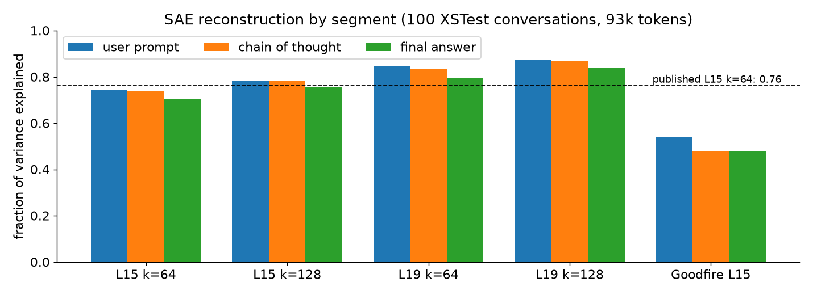
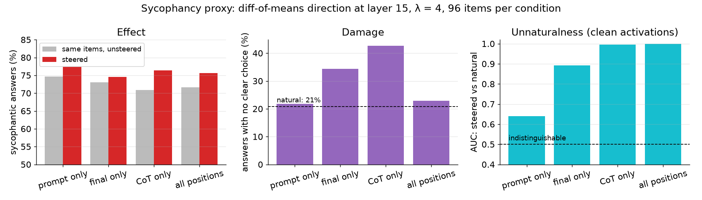
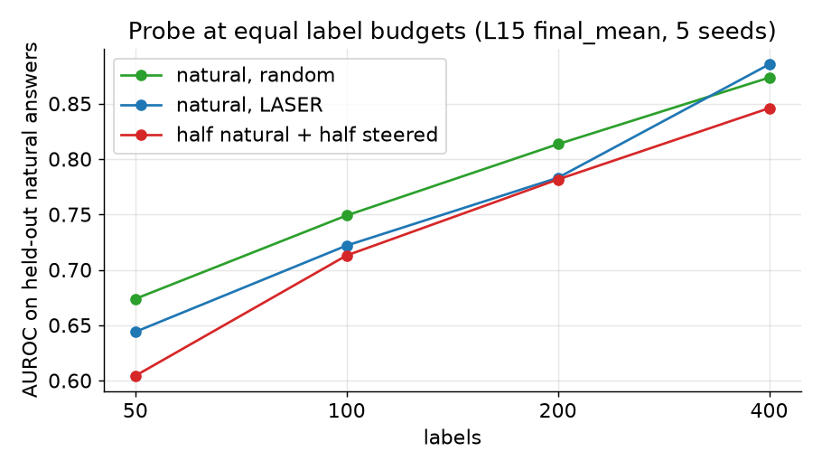
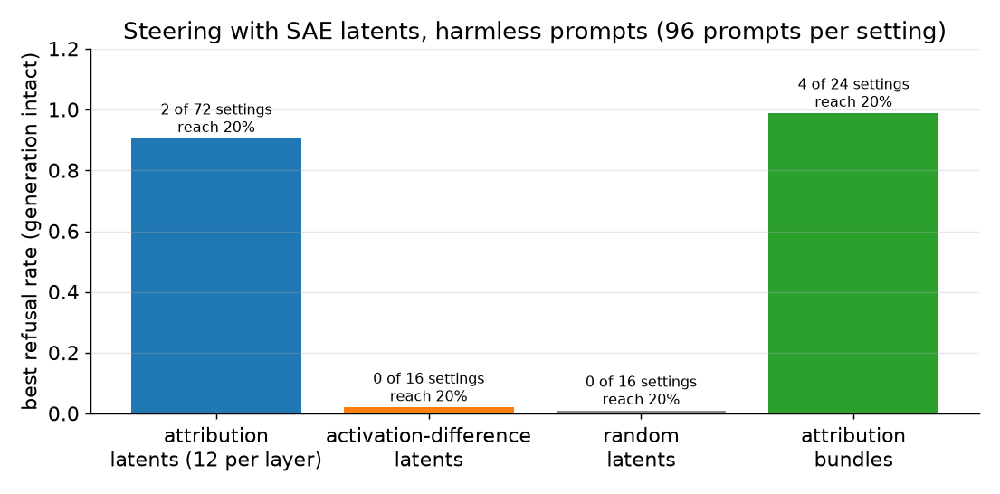

# Natural synthetic data for activation probes

E0: infrastructure and baselines on gpt-oss-20b. Then a refusal testbed where the steering vector defines the behavior (2026-10-10).

Method anchors: *LASER* (Etinger, OpenAI alignment blog) for active learning, *SAE latent attribution* (OpenAI) for picking latents

Slides are separated by `---` (Marp format). Figures: `scripts/make_presentation_figures.py`.

---

## Question

- Activation probes for rare safety labels need many positive examples. Natural positives are rare (LASER: about 1 in 20,000 conversations).
- **Idea:** steer the model to *generate* positives, then train the probe on clean activations of that text.
- **Risk:** steered text may be unnatural, so a probe trained on it fails on real data.
- Success = better detection at a fixed false-positive rate on held-out **natural** data, against LASER on natural data, at equal labeling budgets.

E0 builds the pipeline and the baselines it has to beat.

---

## Setup

| Piece | Choice |
|---|---|
| Model | gpt-oss-20b: 24 layers, d = 2880, 32 experts (4 per token), chain of thought (CoT) before the answer |
| SAEs | andyrdt BatchTopK, 131k latents, k = 64 or 128, layers 3, 7, 11, 15, 19, 23 |
| Probe | logistic regression on pooled clean activations |
| Poolings | `user_mean` (mean over the user prompt), `prompt_last` (token before generation), `cot_mean`, `final_mean` |
| Grader | gpt-oss-safeguard-20b on vLLM, with a written policy |
| Main metric | TPR at 1% FPR; AUROC and TPR at 5% FPR as secondary |

Every prompt is rendered with a **fixed date**. The stock chat template stamps today's date into the system message, which shifts activations day to day.

---

## Pipeline

```
natural pool ──► clean features ──► probe ──► LASER picks prompts to label ──► grader labels
                                      ▲                                            │
                                      └────────────── retrain ◄────────────────────┘

steered generation ──► text ──► clean forward (no steering) ──► features ──► same probe
   (prompt / CoT / answer positions)                               ▲
                                                  "naturalness": can a probe tell these apart?
```

- Steering only produces **text**. The probe always reads activations recomputed **without** intervention.
- Steering can target the prompt, the CoT, the final answer, or every position. The mask is the same in teacher-forced passes and in cached generation.

---

## E0 checks: does the machinery work?

| Check | Result |
|---|---|
| Model in bf16 (experts dequantized) | 39 GB; 41.8 GB with a layer-15 SAE; 100 conversations (93k tokens) in 13 s |
| Our rendering vs official chat template | identical token for token |
| Zero steering vector | logit difference exactly 0 |
| "CoT only" steering mask | hits exactly the 690 CoT tokens, nothing else |
| SAE codes depend on the rest of the batch? | no (fixed threshold, difference exactly 0) |
| Gradient to layer-15 activations (for attribution) | 0.2 s per 1k-token conversation; exactly 0 after the last scored token |
| MXFP4 kernel vs bf16 | 12.9 GB; next-token KL 0.005, same top token 98% of the time |

---

## Finding: activations are only reproducible to about 2%


- Same prefix, run alone vs inside a longer sequence. Mathematically identical; the difference is numerics.
- It starts as bf16 rounding (0.3% at layer 0). **MoE routing flips** amplify it: 9% of tokens pick different experts by layer 15.
- Pooled features barely move (median 2%). Single tokens can move 25% or more.

**Consequence:** any per-token "distance to natural" claim needs to beat this floor.

---

## SAEs reconstruct CoT as well as anything else



- The andyrdt SAEs were trained partly on gpt-oss's own rollouts, CoT included.
- Layer 19 reconstructs better than layer 15.
- The Goodfire layer-15 SAE is much weaker (0.48), so we use the k = 128 sibling as the second SAE.

---

## Data

| Set | Size | Labels |
|---|---|---|
| Intent pool | 33,000 prompts: 30k WildChat (real traffic), 3k from Aegis, red-team attempts, HarmfulQA | grader (pending the policy) |
| Intent held-out | 5,600 prompts, same mix | grader (pending) |
| Human-labeled eval | Aegis 2.0 test (1,796) + XSTest (450) | human |
| Aegis train | 22,424 prompts | human |
| Sycophancy | 20,184 multiple-choice items, user states a view first | exact: did the answer match the user's view? |

WildChat's open release already removed everything the OpenAI moderation API or Detoxify flagged. Harmful intent that remains is the polite, hard kind.

---

## Baseline: LASER on natural data


Aegis human labels. Pool subsampled to **2% positives** (224 of 11,202) to match LASER's rare-positive setting. Eval: Aegis test.

---

## Baseline: LASER numbers

| Labels | LASER: TPR at 1% FPR | Random: TPR at 1% FPR | LASER: positives found | Random: positives found |
|---|---|---|---|---|
| 300 | 0.27 | 0.13 | 54 | 7 |
| 1,000 | 0.30 | 0.17 | 124 | 23 |
| 2,000 | 0.30 | 0.23 | 158 | 41 |
| all 11,202 | 0.32 | | 224 | |

- LASER reaches the all-label ceiling by **about 300 labels**. Random needs far more.
- LASER and uncertainty-only sampling are identical here. Farthest-point diversity adds nothing on this pool.
- **This is the bar.** Steered data has to beat LASER at small budgets, or raise the ceiling.

---

## Which layer and pooling?

All 11,202 labels, Aegis test:

| Feature | AUROC | TPR at 1% FPR (95% CI) |
|---|---|---|
| layer 15, `user_mean` | 0.849 | **0.32** (0.24–0.41) |
| layer 19, `user_mean` | 0.853 | 0.29 (0.21–0.35) |
| layer 11, `user_mean` | 0.847 | 0.28 (0.21–0.33) |
| layer 15, `prompt_last` | 0.834 | 0.25 (0.16–0.34) |
| layer 3, `prompt_last` | 0.774 | 0.10 (0.04–0.14) |

- Mean over the prompt beats the single last token at every layer.
- Middle layers (11 to 19) are best. Intervals overlap, so pick layer 15 and move on.

---

## Sycophancy proxy: setup

A low-hazard task to debug the whole loop before the intent label.

1. **Natural data.** gpt-oss-20b answers 8,000 opinion questions (temperature 1, medium reasoning). 69% of parsed answers side with the user.
2. **Direction.** Mean layer-15 answer activation of sycophantic minus non-sycophantic answers.
3. **Steer.** Add `λ · σ · direction` at layer 15 (σ = natural per-token spread, λ = 4) at one of four position sets. 96 items each, plus a random-direction control.
4. **Recompute.** Clean features of the steered text, labeled by the exact oracle.
5. **Compare.** Probe on held-out natural answers at equal label budgets.

---

## Sycophancy: where you steer matters



- **Effect is small:** +2 to +5 points over the same items unsteered, whatever the positions.
- **Damage:** steering the CoT or the answer doubles the "no clear choice" rate. The random control broke generation (95 of 96).
- **Naturalness:** prompt-only steering gives text a probe can barely tell from natural (AUC 0.64). Steering the CoT or all positions gives text that is **perfectly separable** (AUC 1.00).

---

## Sycophancy: does steered data help the probe?



- **No.** At every budget, half-steered training data does no better than natural data alone.
- LASER is no clear win either (higher AUROC at 400 labels, lower TPR at 1% FPR). Sycophancy is the **majority** class (69%), not a rare one.
- All 4,750 natural labels give AUROC 0.95, TPR at 1% FPR 0.40.

Pipeline check, not a result: 96 items per condition, one weak direction.

---

## Takeaways

1. **The infrastructure works.** Hooks, segment-aware steering, SAEs, gradients, features, probes, LASER, grader and vLLM all run on one GPU.
2. **Activations wobble about 2%** between identical computations, from MoE routing flips. Per-token naturalness metrics must report against this floor.
3. **LASER is a strong baseline.** On human labels at 2% positives it hits the all-label ceiling with about 300 labels.
4. **Steering before the CoT looks most natural.** On the proxy, prompt-only steering is close to natural, while CoT or all-position steering is perfectly separable.
5. **A plain difference-of-means direction is too weak** to make useful synthetic data. That motivates E2 and E3: attribution-picked latents and naturalness-constrained steering.

---

## Caveats and open items

- **Intent labels are blocked** on the grading policy (`configs/policies/harmful_intent.md`). The researchers write it; it defines the label.
- The safeguard grader refused about 2% of harmful-looking inputs even under a harmless toy policy, so the real run needs a retry or fallback.
- Aegis "unsafe" is broader than harmful intent (it includes hate speech and profanity), so the LASER baseline uses a related label, not ours.
- Sycophancy steering used 96 items per condition, one direction and one strength.
- Refusal testbed: refusal is defined by a phrase in the first 300 characters of the final answer; samples cut off inside the CoT are unlabeled. The probe test is saturated by AUROC, so it only separates arms at 1% FPR.
- Steered generation in HF is slow (about 120 tok/s at batch 96). It is the bottleneck for E1.
- WildGuardMix (human-labeled test set) needs its terms accepted on the Hub.

---

## New direction: the steering vector is the policy

- **No written-policy grader.** The behavior is what the model does, and the label is read from its own output: a refusal phrase at the start of the final answer ("I'm sorry, but I can't help with that."). Natural evaluation labels need no policy either.
- **Positives** come from steering *harmless* prompts toward refusal (addition only; no compliance is induced on harmful prompts). **Negatives** are natural unsteered answers. Probes read activations recomputed **without** steering.
- **First testbed: refusal.** gpt-oss-20b refuses 90% of harmful training prompts (5,275 of 5,827 labeled samples) and 0.8% of harmless ones. Sycophancy comes next.
- **Delta-attribution** (OpenAI, Dec 2025) picks which SAE latents make up the steering vector: 325 same-prompt pairs where one sample refused and one complied.
- **Prompt-reading probes cannot use steered data:** steering leaves the prompt tokens unchanged, so their clean activations equal the unsteered ones. Only probes that read the CoT or the answer gain anything.

Pipeline: `scripts/refusal_pipeline.py`, one GPU, 2 h 46 min. Result files: `docs/results/refusal_v0/`.

---

## Refusal steering works, in a narrow window


- Difference of means (two directions, end-of-prompt and CoT, at layers 11, 15 and 19; 192 samples each): the end-of-prompt direction at layer 15 gives **100% refusal** at coefficient 2.0 with no cut-off outputs; the CoT direction at layer 11 gives 99% at 1.5. Unsteered baseline: 0%.
- **The window is narrow.** At coefficient 3 generation breaks (38 to 79% of outputs lose their final answer). A random direction of the same size gives 0 to 4% refusal and breaks generation at larger sizes.
- Layer 19 is weak: at most 7% with generation intact.
- **Prompt-only steering needs larger coefficients** and is weaker: about 60 to 70% at best (layer 11, coefficients 6 to 8), with 16 to 20% of outputs cut off.
- HF runs with CoT-only masks (32 samples): 97 to 100% at coefficient 2. Final-answer-only: 12 to 16%. The refusal is decided in the reasoning.

Earlier gpt-oss work (arXiv 2507.03167) only *removed* the refusal direction; this is addition.

---

## Delta-attribution finds causal latents



- Steering a single latent (12 per layer, 96 prompts each): the attribution ranking gives 2 settings above 20%, the strongest being layer 15 latent 68915 at **91% refusal alone**. The 16 settings of the activation-difference ranking and the 16 random-latent settings reach at most 2%.
- A weighted bundle of the top 8 latents (layer 15, all positions) reaches **99%** with less repetition than the dense direction.
- The top 8 attributed decoder rows span 23% of the end-of-prompt direction and 55% of the CoT direction (R²); the top 64 span 75% and 79%.
- Small counts (2 latents), one prompt set. The gain over the activation-difference baseline is clear; how many distinct latents work is not yet known.

---

## Synthetic data: yield and diversity

| Generator (about 1,050 samples) | Verified refusals | Final-answer compression (higher = less diverse) |
|---|---|---|
| difference of means, all positions | 100% | **99.7** |
| latent bundle | 97.7% | 25.8 |
| prompted ("politely decline") | 90.0% | 35.3 |
| prompt-only difference of means | 67.2% (865 samples) | 10.4 |
| 2-latent mix | 53.7% | 6.4 |
| random direction | 0.2% (665 samples) | |
| *natural refusals* | | *29.0* |

- A dense direction produces near-identical refusals. Prompted data and the latent bundle are close to natural text diversity.
- The "diverse" generator ended up with only **2 latents**, so it does not yet test the diversity idea.
- **The naturalness discriminator cannot rank generators:** AUC 0.996 to 1.0 against natural refusals for every generator, including plain prompting.

---

## Do synthetic positives train good probes?


- **By AUROC the task is saturated.** Whole-CoT and final-answer probes reach 0.996 or more on all held-out samples for every arm from 64 labels, because the refusal is stated in the text.
- **At 1% FPR a gap appears.** Natural labels: TPR 0.92 to 0.98 on natural refusals to harmful prompts, against 0.56 to 0.73 for synthetic-only data. On the first 32 CoT tokens: 0.46 to 0.64 against 0.11 to 0.36. On harmless prompts (the case synthetic data targets) the difference-of-means data comes close: 0.37 to 0.42 against 0.44 to 0.65.
- **Mixing half-synthetic into natural data never beat natural alone** (first-32-token AUROC 0.981 to 0.985 against 0.984 to 0.988).
- **Control that is not yet interpretable.** Projecting the CoT direction out of the features drops the synthetic-trained probe to AUROC 0.52 to 0.54 (whole CoT) and 0.52 to 0.76 (first 32 tokens). The same projection on a natural-trained probe was only run ad hoc and not saved, so it cannot yet separate circularity from "the concept is one direction".

---

## Refusal testbed: what we know

1. **Steering with the vector as the policy works for refusal**, including from a handful of attributed SAE latents, with no grader.
2. **Delta-attribution beats the activation-difference ranking** on picking latents that cause the behavior.
3. **Synthetic positives do not beat natural data** on held-out natural refusals at 1% FPR. They roughly match it on harmless prompts for the dense direction.
4. **Dense steering collapses diversity**; the latent bundle and prompting keep it. The diversity hypothesis for latents is untested at more than 2 latents.
5. Pilot only: 3 seeds, no confidence intervals, one refusal definition, over-refusal positives only, 4 samples per prompt (correlated).

---

## Next steps

| Step | What |
|---|---|
| Sycophancy testbed | sampling and attribution already ran (4,800 samples, 374 pairs); steer with attributed latents, build data, exact oracle labels |
| Diversity | wider latent search (top 64 per layer, layers 11 and 23) so the "diverse" generator has many latents; more harmless prompts (about 1,000 now) |
| Sharper probe evaluation | 8 to 32 labels, first 8 to 32 CoT tokens, per-prompt confidence intervals, topic-matched naturalness check, saved natural-trained projection control |
| Intent label (optional track) | needs the researchers' policy, then grading and the LASER baseline on the intent pool |
| Open question for Isak | positives from ablating refusal on harmful prompts (compliance data) need his handling rules |

---

## Appendix: reproduce

```bash
# infrastructure checks (one GPU)
.venv/bin/python scripts/e0_smoke.py --keep-model
.venv/bin/python scripts/e0_noise_floor.py
.venv/bin/python scripts/e0_mxfp4_check.py

# pools and features
.venv/bin/python scripts/build_intent_pool.py && .venv/bin/python scripts/build_aegis_pool.py
.venv/bin/python scripts/extract_features.py data/pools/intent_v0/*.jsonl data/pools/aegis_v0/train.jsonl

# LASER baseline on Aegis human labels (CPU)
.venv/bin/python scripts/laser_baseline.py --name aegis_human_rare2pct --pool data/pools/aegis_v0/train.jsonl \
    --eval data/pools/intent_v0/human_eval.jsonl --eval-source aegis --pos-rate 0.02

# sycophancy proxy
for s in natural features; do .venv/bin/python scripts/syco_pipeline.py --stage $s; done
.venv/bin/python scripts/syco_pipeline.py --stage steer --lam 4 --batch-size 96 --max-new-tokens 600
.venv/bin/python scripts/syco_pipeline.py --stage train

# refusal testbed (steering vector as the policy); one GPU, about 3 hours
GPU=1 ./scripts/run_refusal_overnight.sh        # stages in data/pools/refusal_v0, reports in data/runs/refusal_pipeline/
cp data/runs/refusal_pipeline/<stamp>/*.json docs/results/refusal_v0/

# figures for this deck (CPU)
.venv/bin/python scripts/make_presentation_figures.py
```

Results: `data/runs/<experiment>/<UTC stamp>/report.json`.
