# Steering-generated positives for activation probes

MATS project 1 (with Isak Etinger), gpt-oss-20b. Status 2026-10-11: infrastructure (E0), a LASER baseline, three passes of refusal and sycophancy testbeds where the steering vector defines the behavior, reachability at scale (E2) and naturalness-constrained generation (E3).

Slides separated by `---` (Marp). Figures: `scripts/make_presentation_figures.py`. Run summaries: `docs/results/*/SUMMARY.md`.

---

## Motivation and question

- Probes on activations are a cheap monitor for rare misaligned behavior, but training them needs positives, and natural positives are rare (LASER: about 1 in 20,000 conversations) and expensive to label.
- **Idea:** let a steering vector *define* the behavior and *generate* positives; label them by reading the model's own answer, recompute clean activations of the text, and train the probe on those.
- **Risk:** steered text may be unnatural or narrow, so a probe trained on it fails on real data.
- **Success:** better detection on held-out **natural** data at a fixed false-positive rate (TPR at 1% FPR) than natural labels, prompted generation or fixed dense steering at the same label budget, or a better warm start for active learning (LASER).

---

## Bottom line so far

1. **Steering is easy to get:** dense directions refuse 100% on harmless prompts; delta-attribution finds 23 refusal and 39 sycophancy SAE latents that work alone; activation-difference and random latents do not.
2. **Synthetic positives do not beat natural labels** at 1% FPR on early-CoT features (refusal: natural 0.66 vs 0.37 to 0.58 at 64 labels), and mixing them in never helps. Whole-CoT probes are saturated, so only early tokens or strict FPRs separate the arms.
3. **The gap is mostly topic:** positives steered on the *same prompts* that natural refusals come from match natural data (0.41 vs 0.40); on harmless prompts they reach 0.15 to 0.24. Keeping natural-looking synthetic text helps (0.28 to 0.46).
4. **Steering has no demonstrated edge over prompting:** prompted positives do about as well as the best steering wherever both were tested (within intervals; better on matched prompts); with an exact label (sycophancy) a **random** direction gives equally good probes.
5. **Making steered text more natural does not close the gap** (E3): choosing the most natural of 8 samples helps a little (+6 points), a per-token cap that keeps activations near natural does not. Diversity from many latents did not help either.
6. **What predicts a latent's usefulness is how reliably it produces the behavior** (Spearman 0.76 over 23 latents), not how close it stays to natural activations (0.37, n.s.; E2).

---

## Setup

| Piece | Choice |
|---|---|
| Model | gpt-oss-20b: 24 layers, d = 2880, 32 experts (4 per token), reasoning (CoT) before the answer; bf16 with dequantized experts for hooks and gradients; medium reasoning effort |
| SAEs | andyrdt BatchTopK, 131k latents, k = 64, residual stream at layers 11, 15, 19, 23 (CoT variance explained 0.74 at L15, 0.83 at L19; Goodfire L15: 0.48) |
| Steering | addition at one layer: difference-of-means directions (end of prompt, CoT, answer) or SAE decoder rows scaled to a latent's mean activation; all positions, or prompt / CoT / answer only |
| Generation | vLLM with steering hooks (about 6,500 tok/s); HF for segment masks (about 120 tok/s) |
| Labels | read from the output: refusal phrase in the answer; sycophancy = answer matches the user's stated view (answer key). Never from the steering vector |
| Probe | logistic regression on pooled clean activations: first 8/16/32 CoT tokens, whole CoT, answer, prompt (L7 to L23) |
| Evaluation | held-out natural data, TPR at 1% FPR (AUROC secondary), 10 seeds, 95% bootstrap intervals that resample whole prompts, paired differences against the natural arm |

Every prompt is rendered with a fixed date (the stock template stamps today's date and shifts activations). Compute: one RTX PRO 6000 (96 GB).

---

## Method

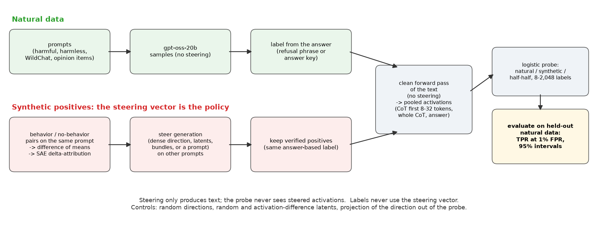

- **Generators:** dense direction (one strength, or several layers and strengths), single attributed latents (one per prompt group), validated bundles, random 3-latent bundles, prompted ("politely decline"), random direction (control).
- **Latent choice:** delta-attribution (OpenAI, Dec 2025) on same-prompt behavior / no-behavior pairs, screened on 64 prompts, validated on 96 fresh ones.
- **Naturalness and diversity:** text compression, precision/recall coverage of natural positives, prompt-matched discriminator, SAE reconstruction error and nearest-neighbor distance of steered activations.

---

## Data

| Dataset | Role | Size |
|---|---|---|
| Refusal prompt sets (arXiv 2507.03167) | natural refusal/compliance samples, directions, attribution; test set | train 1,459 harmful + 1,174 harmless prompts; test 487 + 250 |
| XSTest | borderline prompts in the refusal test set | 450 prompts |
| Aegis 2.0 | refusal training prompts (600); LASER baseline with human labels | 22,424 train, 1,796 test |
| WildChat-1M, benign open release | synthetic-data prompts, natural over-refusals, LASER pool, prompt-matched test | 4,000 prompts x 2 samples, 356 natural refusals (4.7%); 178 naturally refused training prompts |
| Model-written evals, sycophancy (NLP survey, political typology) | sycophancy natural data and steering items | 6,000 train + 2,000 held-out items |
| Intent pool (WildChat 30k + red-team, Aegis, HarmfulQA 3k) | optional harmful-intent track | 33,000 + 5,600 held-out; grading blocked on the policy |

Natural refusal samples: 28,889 labeled (24,200 train, 4,689 test). Synthetic: 3,000 harmless prompts per refusal generator (about 33,000 samples), 1,500 items per sycophancy generator.

---

## Experiments run

| Run | Date | GPU time | What it tested |
|---|---|---|---|
| E0 | 10-08 | not logged | hooks, masks, SAEs, gradients, noise floor, LASER baseline (Aegis), sycophancy proxy |
| Refusal pilot (`refusal_pipeline.py`) | 10-10 | 2.8 h | directions, steering sweep, attribution (325 pairs), first synthetic data and probes (3 seeds) |
| Second pass (`steer_v1.py`, `steer_v1_extra.py`) | 10-10 | 7.2 h | 1,500-pair attribution on 4 layers, 288-condition latent screen, 7 generators x 3,000 prompts, probes with intervals; sycophancy testbed; LASER warm start, WildChat probes, reachability, steering timing |
| Third pass (`steer_v2.py`) | 10-11 | 7.1 h | 501-condition wider latent screen, many-latent generators, prompt-matched positives, naturalness filter, multi-layer and layer sweep; sycophancy wider screen, random-direction control, budgets to 2,048 |
| E2 and E3 (`steer_e3.py`) | 10-11 | 1.3 h | distance from natural for 24 refusal and 40 sycophancy latents vs yield and data usefulness; per-token capped steering, best-of-8 selection by a discriminator, on harmless and naturally refused prompts |

---

## E0: the machinery works, activations wobble about 2%

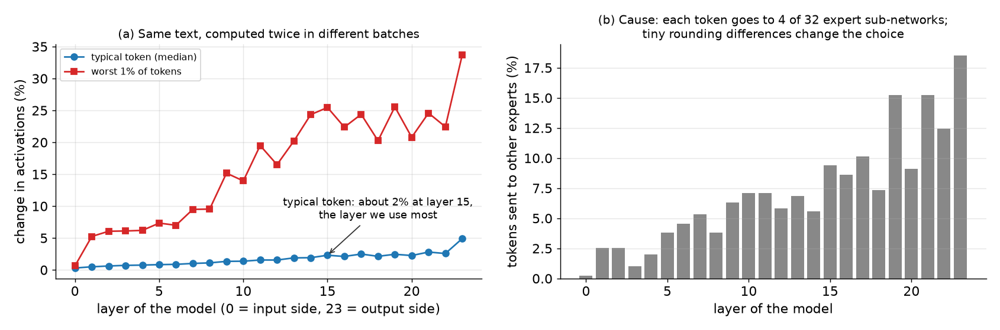

- Checks pass exactly: rendering equals the official template; zero vector changes nothing; a CoT-only mask hits exactly the 690 CoT tokens; SAE codes do not depend on the batch; gradients to layer 15 take 0.2 s per 1k-token conversation; MXFP4 vs bf16 next-token KL 0.005.
- The same prefix alone vs inside a longer sequence differs by about 2% (median) at layer 15, from MoE routing flips (9% of tokens pick other experts). Per-token distance claims must beat this floor.

---

## Baseline: LASER on natural labels

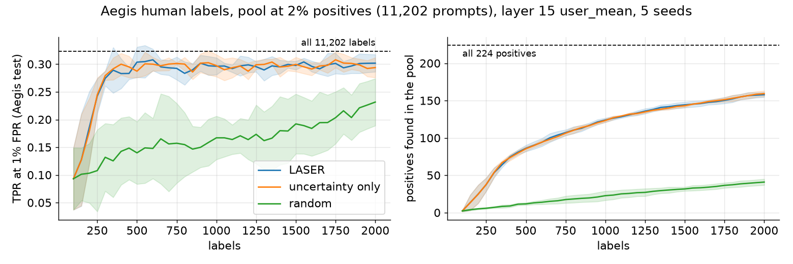

- Aegis human labels, pool at 2% positives (224 of 11,202). LASER reaches the all-label ceiling (TPR 0.32 at 1% FPR) by **about 300 labels** (random: 0.13); it finds 54 positives in 300 labels vs 7.
- Mean over the prompt beats the last token; layers 11 to 19 are best (layer 15 picked). This is the bar steered data has to beat.

---

## Refusal: steering the model toward refusal

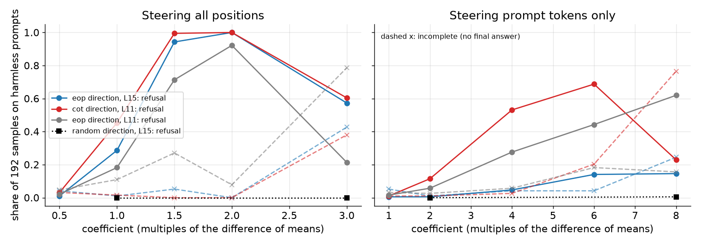

- **(a)** The end-of-prompt direction at layer 15 gives 100% refusal on harmless prompts at strength 2; at 3 outputs get cut off; random directions do nothing.
- **(b)** Attribution finds causal latents, but most need strength 8 to 12: 4 work in the first screen, 23 in the wider one (up to 100% alone; a 4-latent bundle 98%). Activation-difference and random latents: 0 of 32.
- **(c)** Steering acts through the chain of thought: CoT-only masks give 97 to 100% for the dense direction and a bundle (22 to 78% for single latents); prompt-only gives at most 19%, answer-only at most 38%.

---

## Refusal: synthetic positives vs natural labels

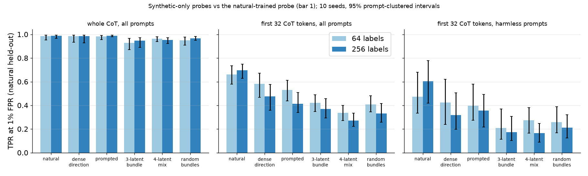

- On the first 32 CoT tokens natural labels win at every budget (0.66 at 64 labels, 0.70 at 256); the best synthetic arms reach 0.53 to 0.58, the 23-latent mix 0.37 and falls to 0.17 with more labels. Half-natural mixes stay below natural (-0.02 to -0.12).
- Whole-CoT probes are saturated (0.97 to 0.99 for every arm): gpt-oss states refusal in the CoT, so separation needs early tokens and 1% FPR. First 8 tokens: natural 0.50 to 0.55, synthetic 0.08 to 0.30.
- Projecting the CoT direction out collapses the natural-trained probe as well (whole-CoT AUROC 1.00 to 0.61): refusal is one direction for every arm, so this control cannot show circularity.

---

## Why the gap: topic, then naturalness

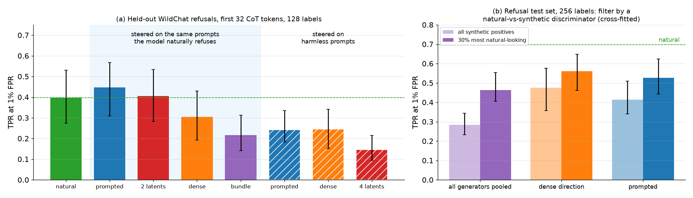

- **(a)** On held-out WildChat refusals, positives steered on the 178 prompts the model naturally refuses match natural data (prompted 0.45, two latents 0.41, natural 0.40); the same generators on harmless prompts lose 0.15 to 0.25. Dense and bundle steering still lose on matched prompts: their text is the least natural.
- **(b)** Keeping the 30% of synthetic positives a cross-fitted discriminator finds most natural lifts every generator (pooled 0.28 to 0.46, dense 0.48 to 0.56, prompted 0.41 to 0.53), still below natural (0.70).
- Diversity is not the lever: final-answer compression (lower = more diverse) is natural 9, prompted 15, latent mixes 19 to 35, dense 134, yet the most diverse latent mixes are the worst arms; coverage of natural refusals is low for all (recall 0.00 to 0.09).

---

## Why the gap: probe layer and activation manifold

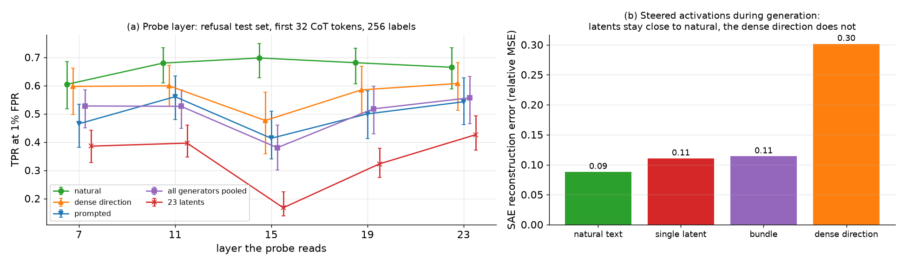

- **(a)** The gap is largest where natural probes are best (layer 15: 0.70 vs 0.48 for dense) and vanishes at layer 7 (0.60 vs 0.60); consistent with prompt topic being read at middle layers. Concatenating layers 11, 15 and 19 adds 3 to 5 points to dense arms only.
- **(b)** During generation, latent steering keeps activations close to natural (reconstruction error 0.11, nearest natural neighbor 0.53 to 0.56 of the norm, natural 0.53), the dense direction does not (0.30, 0.64). Yet latent data trains worse probes: closeness to the manifold does not predict transfer.

---

## E2: distance from natural activations, effect and usefulness

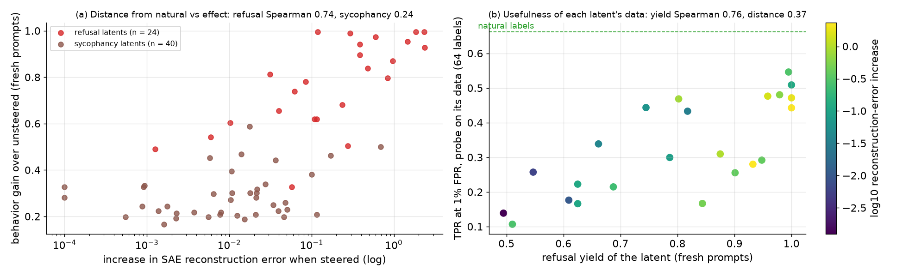

- **(a)** For refusal, the further a latent moves activations from natural (SAE reconstruction error), the more it refuses (Spearman 0.74, 24 latents): a smooth trend, not two regimes, and near-natural latents still add 50 points. Strength-8 and -12 latents run at about 4x the natural error (0.32 vs 0.07). Sycophancy latents stay near natural (0.10) with no clear relation (0.24). Nearest-neighbor distance predicts little.
- **(b)** A probe trained only on one latent's positives is better when the latent refuses reliably (Spearman 0.76, p < 0.001), not when it stays near natural (0.37, n.s.). The best latents include near-natural (27857) and far-off ones (98869); none reaches natural labels (0.66).

---

## E3: naturalness-constrained generation

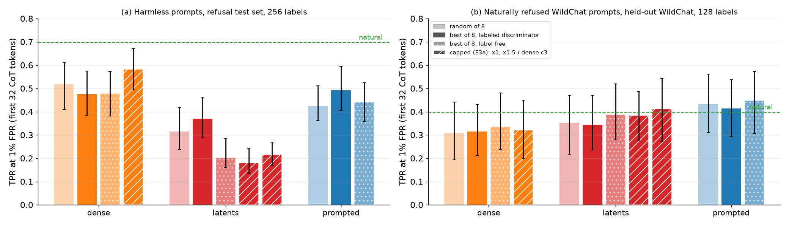

- **E3b, best of 8:** keeping the sample a discriminator trained on 128 natural refusals finds most natural adds about 6 points for latents and prompted text (latents 0.31 to 0.37, prompted 0.43 to 0.49 at 256 labels; first 16 tokens, prompted 0.19 to 0.34); a label-free discriminator (any natural output) hurts. Weaker than ranking all positives (the earlier top-30% filter, +18).
- **E3a, per-token cap** at the natural 90th-percentile reconstruction error: keeps 83% of the dense strength and 50% of the latents'. It hurts latent data on harmless prompts (0.18 to 0.22) and helps the dense direction only at strength 3 (0.58 vs 0.52). On naturally refused prompts, capped latents and prompted text match natural (0.38 to 0.45 vs 0.40), as uncapped latents did before.
- Every synthetic-only arm stays below natural on harmless prompts (best 0.58 vs 0.70); naturalness is a second-order lever after topic.

---

## Where synthetic positives help: LASER warm start

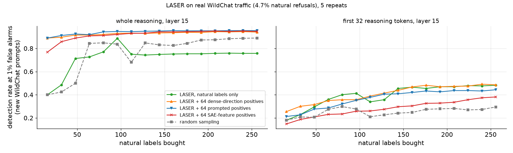

- Benign WildChat traffic, 4.7% natural refusals. On whole-CoT features, 64 free synthetic positives lift TPR at 1% FPR after 32 natural labels from 0.49 to 0.86 to 0.91, and at 256 labels from 0.76 to 0.94. **Prompted positives give the same gain**; on the first 32 tokens there is no gain.
- Here LASER on natural labels alone plateaus below random sampling (0.76 vs 0.89 at 256): its selected pool is skewed. The warm start fixes that, whatever the source.

---

## Sycophancy: easy to steer, hard to detect

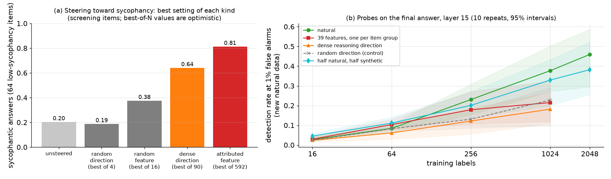

- **(a)** Low-sycophancy items (baseline 20%): the CoT direction at layer 11 reaches 64%, the best attributed latent 81% on screening items (39 of 40 latents hold up on fresh items, best 69%, bundle 74%). Random latents reach 38%, so part of the effect is non-specific. The E0 proxy (one answer direction) gave only +2 to +5 points.
- **(b)** Natural probes keep improving with labels (0.23 at 256, 0.46 at 2,048); synthetic-only plateaus near 0.2. A **random direction** trains probes as well as the chosen ones: with an exact answer-key label the vector is only a sampler. Length matching changes nothing (length-only probe AUROC 0.66).

---

## What we learned

1. **The steering vector can define a behavior and generate it reliably,** and delta-attribution picks causal latents that activation differences miss.
2. **What makes steered data useful is where it comes from, not how it is steered:** shared prompts with natural positives close the gap; natural-looking text helps a little; more latents, more diversity, or keeping activations near natural (E2, E3a) do not. Among latents, reliable ones make better data.
3. **Prompting is a strong baseline.** No experiment shows steering beating a one-line instruction on the same prompts.
4. **Where labels are exact, the vector does not matter** (sycophancy): the case for steering is behaviors that cannot be elicited or verified otherwise.
5. **Evaluation must be strict:** whole-CoT probes saturate for refusal; differences appear only at 1% FPR on early CoT tokens, with intervals over prompts.

---

## Caveats

- Refusal positives are over-refusals on harmless or naturally refused prompts; steering harmful prompts (ablation, compliance data) waits for Isak's handling rules.
- The refusal label is a phrase in the final answer (cut-off samples unlabeled); prompt-matched positives cover 178 WildChat prompts, and held-out prompts differ but cluster by topic.
- Sycophancy is a majority behavior naturally (69%), its items have exact keys, and the strongest steering shortens the CoT (540 to 160 tokens).
- Screening values are best-of-N on 64 items; validation on 96 fresh items is the number to trust.
- Intent labels are blocked on the researcher-written policy; the safeguard grader refused about 2% of harmful-looking inputs under a toy policy.

---

## Next steps

| Step | What | Needs |
|---|---|---|
| Topic-matched positives at scale | steer the prompts natural positives come from (borderline and harmful), compare steered, prompted and natural on the same prompts and budgets | Isak's handling rules |
| A behavior prompting cannot elicit | a testbed where the label exists only through the vector (no answer key, hard to prompt), where steering could add something | choice of behavior |
| Reliability-selected latents | build generators from the highest-yield latents only (yield predicts usefulness) and test them on matched prompts | none (GPU, about 2 h) |
| LASER with a warm start | prompted warm start as reference, rare-positive pools near 1% | none (CPU) |
| E2 search and E5 (prompt recovery) | look for inputs that reach steered states without steering; lower priority since closeness to natural did not predict usefulness | none (GPU, days) |
| Intent label (optional) | grading, validation against human labels, LASER on the graded pool | the policy |

---

## Appendix: reproduce

```bash
source env.sh                                                    # shared caches; see docs/HANDOFF.md for a new machine
.venv/bin/python scripts/e0_smoke.py --keep-model                # E0 checks (also e0_noise_floor.py, e0_mxfp4_check.py)
.venv/bin/python scripts/laser_baseline.py --name aegis_human_rare2pct --pool data/pools/aegis_v0/train.jsonl \
    --eval data/pools/intent_v0/human_eval.jsonl --eval-source aegis --pos-rate 0.02
GPU=1 ./scripts/run_refusal_overnight.sh                         # refusal pilot, about 3 h
GPU=1 PIPELINE=steer_v1.py ./scripts/run_refusal_overnight.sh     # second pass, about 6 h
GPU=1 PIPELINE=steer_v1_extra.py ./scripts/run_refusal_overnight.sh   # extras, about 1 h
GPU=1 PIPELINE=steer_v2.py ./scripts/run_refusal_overnight.sh     # third pass, about 7 h
GPU=1 PIPELINE=steer_e3.py ./scripts/run_refusal_overnight.sh     # E2 at scale and E3, about 1.5 h
.venv/bin/python scripts/make_presentation_figures.py            # figures (CPU)
```

Every runner stage is resumable; `--smoke` runs tiny sizes. Readable summaries: `data/pools/steer_v*/SUMMARY.md`, copied with the report JSONs to `docs/results/`.
